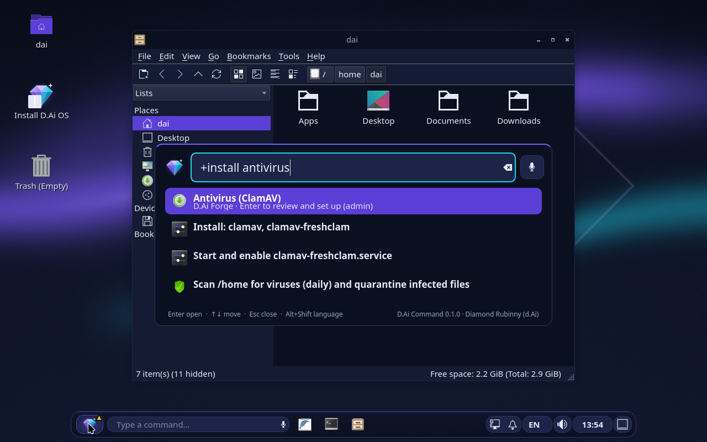
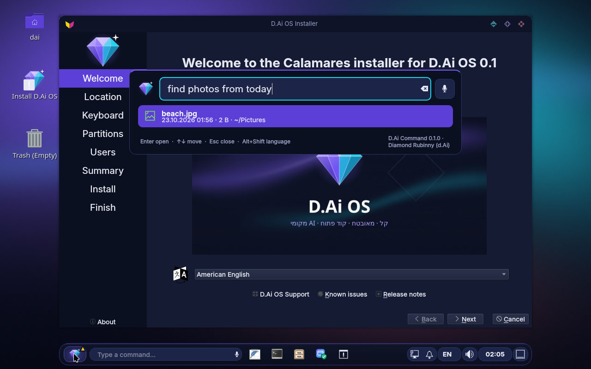
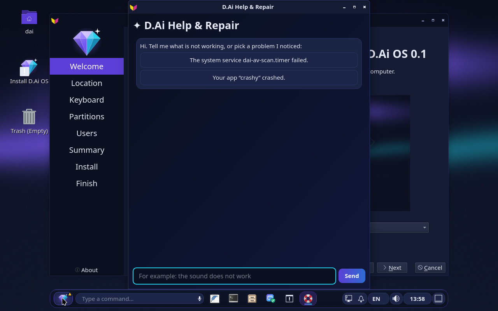
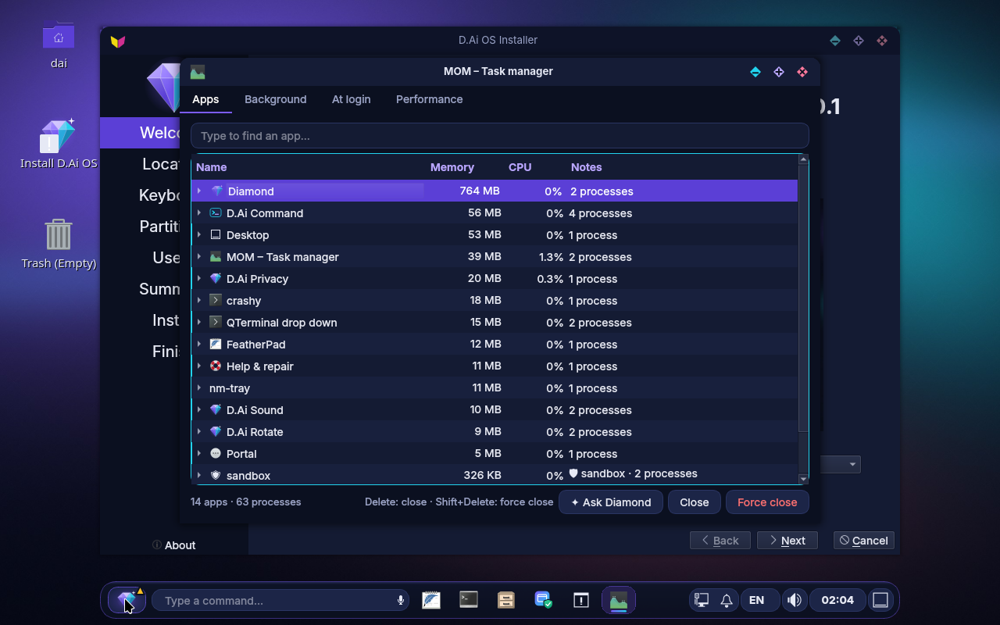
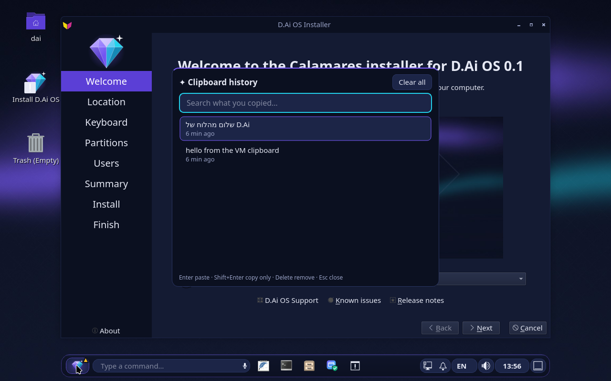
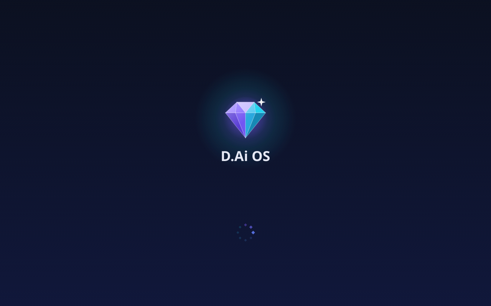

# D.Ai OS

🌍 **English** · [עברית](#בעברית) · [العربية](docs/readme/README.ar.md) · [Русский](docs/readme/README.ru.md) · [Español](docs/readme/README.es.md) · [Français](docs/readme/README.fr.md) · [Deutsch](docs/readme/README.de.md) · [Português](docs/readme/README.pt.md)

**A free, secure, open-source Linux desktop with a built-in local AI, a Hebrew-first experience in eight languages, and a builder that extends the system from plain text.**

🌐 **Website:** [rubinny.com](https://rubinny.com) · ⬇️ **Download:** [latest release](https://github.com/diamondrubinny/D.Ai/releases/latest)

Based on Debian 13 · LXQt on labwc (Wayland) · Apache-2.0


> **Status:** early development. The first working version builds and boots in CI; the installer works but a full end-to-end install is not yet automated. Not recommended as your only operating system.

---

## Why D.Ai OS

- **Private AI that stays on your computer.** A local model (llama.cpp) runs on a UNIX socket only. The AI service has no network access.
- **Configure the system by describing it.** Type what you want in Hebrew or English. Nothing you type ever becomes a shell command. It becomes a reviewable plan, with undo.
- **Extend the system by asking.** Ask for an antivirus, file sync, or a custom app. D.Ai Forge builds it, you review it, and it is installed.
- **A system that develops and repairs itself.** Every app the AI builds is tested in a sandbox and repaired before you see it; ask for an automation and it runs on a schedule; it notices what you are missing and suggests it; when something crashes, a chat explains it and fixes it with your OK.
- **Hebrew and RTL done properly.** HE/EN indicator, wrong-layout fixer (`akuo` becomes `שלום`), Hebrew app names and Hebrew voice dictation.
- **Secure by default.** Default-deny firewall, AppArmor, kernel hardening, locked root, automatic security updates, full-disk encryption in the installer.
- **Eight languages.** Hebrew, English, Arabic, Russian, Spanish, French, German and Portuguese: the interface, the sentences D.Ai understands, the boot menu and the website.
- **Beautiful from the first second.** A D.Ai boot menu, a loading screen where the encrypted disk asks for its passphrase, a D.Ai login screen, and three themes (Night, Day, high contrast) that every window follows.
- **PDFs in a sandbox.** D.Ai PDF opens every file in a bubblewrap sandbox, shows what the file wants to do (JavaScript, launching programs, sending forms) and never does it; pages, forms, notes, a stamped signature, real redaction, OCR and a smaller file, all edited inside the sandbox.
- **Windows in a window.** D.Ai VM runs Windows from your own installation media with your own key (KVM, UEFI with Secure Boot, TPM 2.0), with no shared folder, clipboard or USB until you flip each switch. D.Ai never ships Windows.
- **On the TV, on a phone, on ARM.** The tv edition boots into Kodi in Hebrew and is driven by the remote; experimental arm64 images of the phone (Phosh) and of the TV build and boot in QEMU in CI.

## Screenshots

Every picture is taken automatically in CI, from the ISO booted in a virtual machine.

| | | |
|---|---|---|
|  |  |  |
| **Diamond**: `?` and a question, answered on this computer | **D.Ai Forge**: `+install antivirus` shows the plan first | **D.Ai Quick**: everything quick, with the security score |
|  |  |  |
| **J**: mail, signed and encrypted, imports from Outlook | **D.Ai Find**: files by meaning and date | **D.Ai Heal**: explains a crash and offers a fix |
|  |  |  |
| **MOM**: apps, not processes, explained in plain words | **D.Ai Clip**: never keeps passwords | **Welcome** in Arabic, right to left |
|  |  |  |
| **Boot menu**: "Start D.Ai OS", eight languages | **Loading**: the diamond (and the disk passphrase) | **Login**: clock, keyboard language, Caps Lock warning |
|  |  |  |
| **D.Ai TV**: Kodi in Hebrew on the TV, nothing listening | **D.Ai Phone** (experimental): Phosh on arm64, booted in QEMU | **D.Ai TV on arm64** (experimental): the same Kodi, a generic UEFI image |
|  |  | |
| **D.Ai PDF**: what the file wants is shown in the bar, never done | **D.Ai VM**: the hardware check, and what Windows can see | |

## What's included

| Component | What it does | Docs |
|---|---|---|
| **D.Ai Night desktop** | A floating taskbar with the Living Diamond (status at a glance), a real command field, HE/EN indicator, lock screen | `docs/DESIGN.md`, `docs/TASKBAR.md` |
| **Themes** | D.Ai Night, D.Ai Day and high contrast in every D.Ai window (`dai_style`), chosen in one sentence: "light theme" | `docs/V2.md` |
| **The way to the desktop** | D.Ai boot menu (BIOS and UEFI), Plymouth loading screen, SDDM login screen, translated and right-to-left | `docs/V2.md` |
| **D.Ai Command** | Launch apps (also by Hebrew name), commands, safe calculator, layout fixer. `?` asks the local AI, `!` opens Tune, `+` opens Forge | |
| **D.Ai Tune** | Configure the system in text, through a closed catalog of validated actions, a root helper that re-validates everything, a journal and undo, and a security score | `docs/TUNE.md` |
| **Local AI** | Pinned llama.cpp, models downloaded on demand with pinned SHA-256, automatic coder model for code | `docs/AI.md` |
| **D.Ai Forge** | Recipes (antivirus, Syncthing, Flathub, Podman, WireGuard, Nextcloud, Steam, OnlyOffice and more), an AI app builder with sandboxed apps, the Workshop (build → test → repair) and scheduled automations | `docs/FORGE.md`, `docs/EVOLVE.md` |
| **D.Ai Evolve** | Notices what you are missing (a file no program opens, a command you repeat, a request it could not fulfil) and suggests building it, in D.Ai Command | `docs/EVOLVE.md` |
| **D.Ai Heal** | When a program crashes or a service fails: a notification, a chat that explains it in plain words, and fixes from a closed list applied only when you click (`Super+F1`) | `docs/EVOLVE.md` |
| **D.Ai Voice** | Local Whisper dictation and voice commands | `docs/VOICE.md` |
| **D.Ai Code** | Local coding assistant: explain, review, edit with diff and undo | |
| **D.Ai Find** | "Find the PDF I downloaded last week", in Hebrew or English | `docs/FIND.md` |
| **D.Ai Doctor** | Why is it slow, what fills the disk, battery health, hardware check | `docs/DOCTOR.md` |
| **D.Ai Privacy** | Microphone and camera indicator with a local log | `docs/PRIVACY.md` |
| **D.Ai Backup** | Encrypted automatic backups (restic) to an external drive | `docs/BACKUP.md` |
| **D.Ai Move** | Bring your files and bookmarks over from Windows | `docs/MOVE.md` |
| **D.Ai Clip** | Clipboard history (Super+V) that never keeps passwords | |
| **D.Ai Quick** | Wi-Fi, do not disturb, battery saver, volume, security score and who used the camera, next to the clock (Super+N) | `docs/TASKBAR.md` |
| **J** | Mail in Hebrew: finds the server settings by itself, OpenPGP and S/MIME, no tracking pixels, imports mbox, Maildir and Outlook PST | `docs/MAIL.md` |
| **Ruby** | The browser: Firefox ESR with strict tracking protection, uBlock Origin and containers | `docs/BROWSER.md` |
| **MOM** | The task manager: apps instead of processes, explained by Diamond, and a guard against runaway programs (Ctrl+Shift+Esc) | `docs/MOM.md` |
| **Raz** | Checks the system before and after every update; every D.Ai window passes an accessibility check in three themes before release | `docs/RAZ.md` |
| **D.Ai Rescue** | From the USB stick: when the installed system no longer starts after an update, go back to before it | `docs/BASICS.md` |
| **D.Ai sounds** | "The diamond family": crystal sounds from one musical family, soft and short, for login, notifications, USB devices, the charger, screenshots and copied text; "quiet sounds" or "turn off sounds" in one sentence | `docs/SOUNDS.md` |
| **D.Ai OCR** | Super+Shift+T: choose an area of the screen and its text is copied, read on this computer in eight languages | `docs/V2.md` |
| **D.Ai PDF** | The PDF reader and editor: every file opens in a bubblewrap sandbox, and what the file wants to do (JavaScript, launching programs, sending forms, attachments) is shown in a bar and never done. Links ask first. Hebrew made readable, search, outline, print; pages turned, moved, removed, merged and split; forms filled and flattened; highlights, notes, text and a stamped signature; every edit saved by the sandbox | `docs/PDF.md` |
| **D.Ai VM** | Windows in a window, with your own installation media and your own key: KVM, UEFI with Secure Boot, TPM 2.0 and VirtIO drivers, so Windows 11 installs; runs as you with no shared folder, no clipboard and no USB until you flip each switch; snapshots before an update; a machine is an app: in the menu, in MOM, explained by Doctor, a choice in Backup. D.Ai never downloads or ships Windows. User and dev editions | `docs/VM.md` |
| **Diamond Chat** | Encrypted messages and pictures between D.Ai computers, with no server and no account: directly on the local network, or through Tor onion services on the internet. Pairing by swapping codes and comparing six symbols; pictures are re-drawn in a sandbox without their location. Off until you turn it on. **Needs an external security review before release** | `docs/SEND.md` |
| **The basics** | Screenshots (Print), night light, on-screen keyboard, magnifier, drives that mount by themselves, printers with no driver, firmware updates | `docs/BASICS.md` |
| **D.Ai Welcome** | First-run setup wizard | `docs/WELCOME.md` |
| **D.Ai OEM** | Prepare a computer for its new owner (refurbishers, charities) | `docs/OEM.md` |
| **Installer** | Calamares with LUKS full-disk encryption, D.Ai branded | `docs/INSTALL.md` |
| **Snapshots** | Btrfs and snapper snapshots before updates, with a way back | `docs/SNAPSHOTS.md` |

### Editions

- **user**: the everyday desktop
- **dev**: user edition plus developer tools
- **edu**: user edition plus learning apps (GCompris, Tux Paint, TuxMath, Stellarium, KDE Edu, Marble) and organization policies for schools
- **tv**: the television edition for a computer on the TV's HDMI: boots into Kodi full screen in Hebrew, driven by the TV's remote (CEC); no telemetry, no account, nothing listening; "Exit" reaches the desktop (`docs/TV.md`). Also built for arm64 (`DAI_ARCH=arm64`, a generic UEFI image for ARM boxes; experimental, `docs/TV.md` §14)
- **phone** (experimental, arm64): Debian's Phosh shell with Calls, Chatty and the D.Ai apps in touch mode; builds and boots in QEMU in CI, no real phone tested yet (`docs/MOBILE.md`)
- **server**: no desktop, hardened for internal servers (`docs/SERVER.md`); not built in CI yet

## D.Ai Forge


Press `Super+B`, or type `+` in the command field, and say what the computer should be able to do:

```
+ install an antivirus
+ add file sync
+ build an app for ...
```

Every recipe becomes a D.Ai Tune plan that is reviewed, authorized by polkit, validated again by the root helper, journaled and undoable. Apps built by the local AI run in a **bubblewrap sandbox**.

Before you see an app, the **Workshop** starts it in a stricter sandbox (no network, no home, no display). If it crashes, the AI fixes it from the error and tests again, at most twice. Ask for something recurring (`+ every morning tell me if the disk is almost full`) and it becomes an **automation**: a user-level systemd timer that runs the script in the sandbox and shows its result as a notification (`dai-forge auto list`).

## Security model, in short

- Text is never executed. It is parsed into requests for a **closed catalog** of typed actions.
- Weakening changes need a typed confirmation, and `--yes` is refused for them.
- AI-written plans are labelled, need manual review, and can only use catalog actions.
- The AI service runs with `RestrictAddressFamilies=AF_UNIX`, so it has no network.
- Models and releases are verified by pinned SHA-256 and signatures. D.Ai packages come from a signed repository, pinned so it can never replace a Debian package.

Details and threat models are in `docs/TUNE.md` and `docs/FORGE.md`. To report a vulnerability, see `SECURITY.md`.

## Try it

1. Download an ISO from the [Releases](https://github.com/diamondrubinny/D.Ai/releases) page, once a release is published.
2. Write it to a USB stick.
3. Boot it and try it live. In the live session, `dai-doctor hardware` or "will my wifi work?" in the command field checks your hardware.
4. Install with **Install D.Ai OS** and keep **Encrypt system** ticked.

Coming from Windows? Read `docs/FROM-WINDOWS.md` first.

## Build from source

The build runs as root inside a disposable Debian 13 (trixie) container, because live-build makes chroots:

```bash
# build one edition: user, dev, edu, tv, server or phone
docker run --rm --privileged -v "$PWD:/src" -w /src debian:trixie \
  bash build/scripts/build-iso.sh user /src/out

# the tv edition for arm64 (built through QEMU user emulation: slow)
docker run --rm --privileged -e DAI_ARCH=arm64 -v "$PWD:/src" -w /src debian:trixie \
  bash build/scripts/build-iso.sh tv /src/out

# boot an ISO in QEMU
build/scripts/run-qemu.sh out/dai-os-user-*.iso
```

CI (`.github/workflows/build-iso.yml`) runs ShellCheck and unit tests, builds llama.cpp, whisper.cpp, the panel plugin and every ISO in `debian:trixie`, boots each ISO in QEMU/KVM, runs in-guest checks and publishes screenshots. The arm64 phone and TV images are built and booted under emulation in jobs of their own, which cannot fail the workflow while they are being proven.

## Repository layout

```
apps/      D.Ai applications (command, tune, ai, forge, voice, code, ...)
build/     live-build configuration and build scripts
docs/      design, security model and user guides
site/      the website (rubinny.com), eight languages, built from site/src
tests/     unit, VM and apt-repository tests
```

## Known limitations

- Sandboxed apps are not yet exposed to screen readers. This needs an accessibility and security review.
- ClamAV scans on a schedule. On-access scanning is not enabled yet.
- App quality depends on the local model (the 1.5B coder model is recommended).
- The end-to-end install is not automated in CI yet.
- Secure Boot: the USB stick boots through Debian's signed shim; this still needs checking on real hardware with Secure Boot on.
- `grub-btrfs` is not available in Debian 13, so going back to a snapshot from the boot menu is done with D.Ai Rescue from the USB stick instead.
- The panel, the window borders and Firefox do not follow the light theme yet.

See `docs/PLAN.md` for the roadmap.

## Support the project

D.Ai OS is free and open source and stays that way. If you want to help it move forward, the **Sponsor** button
on this repository and [rubinny.com/#support](https://rubinny.com/#support) take a one-time ($5, $10, $25,
$100) or monthly ($5, $10, $25) amount through GitHub Sponsors; the page says where the money goes (CI minutes,
test hardware, signing and certificates, the legal, accessibility and security reviews). Supporters are listed
in `SPONSORS.md`.

## Contributing

Contributions are welcome. Please read `CONTRIBUTING.md` first. The project uses the Developer Certificate of Origin (DCO), so sign off your commits with `git commit -s`. Please follow `CODE_OF_CONDUCT.md`.

## License and credits

Copyright (c) 2026 Diamond Rubinny (d.Ai). The code is licensed under Apache-2.0: copies must keep `LICENSE`, `NOTICE` and the copyright notices in the files.

**"D.Ai", "D.Ai OS" and the diamond logo are trademarks.** The license grants no rights to them, so modified versions may not be distributed under the D.Ai name or logo, or presented as official. See `TRADEMARKS.md`. Terms of use and privacy policy: [rubinny.com](https://rubinny.com/terms.html) (pending legal review before the site goes live). Debian packages in the images keep their own licenses.

Created by **Diamond Rubinny (d.Ai)**. Built with [Claude Code](https://claude.com/claude-code).

---

## בעברית

**D.Ai OS** היא מערכת הפעלה חופשית, מאובטחת ובקוד פתוח (מבוססת Debian 13) עם AI מקומי שרץ על המחשב שלכם, ממשק עברית מלא, ומבנה שמאפשר להרחיב את המערכת רק באמצעות טקסט.

- **AI פרטי:** המודל רץ מקומית, ושירות ה-AI לא מחובר לרשת.
- **תמיכה בפרויקט:** כפתור Sponsor בריפו, או [rubinny.com/#support](https://rubinny.com/#support): סכום חד-פעמי או חודשי דרך GitHub Sponsors, והדף אומר לאן הכסף הולך.
- **הגדרות בטקסט:** כותבים מה רוצים ("חסום USB", "פתח פורט"), מקבלים תוכנית לבדיקה ואישור, ותמיד אפשר לבטל.
- **D.Ai Forge:** כותבים `+ תתקין אנטי וירוס`, והמערכת בונה תוכנית, אתם בודקים, והיא מותקנת. אפשר גם לבקש בניית אפליקציה.
- **מערכת שמפתחת ומתקנת את עצמה:** כל אפליקציה שה-AI בונה נבדקת בארגז חול ומתוקנת לפני שאתם רואים אותה; אוטומציות רצות לפי לוח זמנים; וכשמשהו קורס, נפתח צ'אט שמסביר ומתקן באישורכם.
- **עברית ו-RTL:** מחוון HE/EN, תיקון הקלדה בפריסה שגויה (`akuo` ל-`שלום`), הכתבה בעברית וחיפוש קבצים בעברית.
- **אבטחה כברירת מחדל:** חומת אש, AppArmor, הצפנת דיסק מלאה בהתקנה, גיבוי מוצפן ועדכוני אבטחה אוטומטיים.
- **שמונה שפות:** עברית, אנגלית, ערבית, רוסית, ספרדית, צרפתית, גרמנית ופורטוגזית.
- **יפה מהשנייה הראשונה:** תפריט אתחול, מסך טעינה ומסך כניסה בעיצוב של D.Ai, ושלוש ערכות נושא (כהה, בהירה וניגודיות גבוהה).
- **PDF בארגז חול:** ‏D.Ai PDF פותח כל קובץ בארגז חול, מראה מה הקובץ "רוצה" לעשות (JavaScript, הרצת תוכניות, שליחת טפסים) ולא עושה זאת לעולם; עריכה של עמודים, טפסים, הערות, חתימה מוטבעת, השחרה אמיתית, OCR וקובץ קטן יותר, הכול בתוך ארגז החול.
- **Windows בחלון:** ‏D.Ai VM מריץ Windows מהמדיה ומהמפתח שלכם (KVM, ‏UEFI עם Secure Boot, ‏TPM 2.0), בלי תיקייה משותפת, לוח או USB עד שתפעילו כל אחד מהם. D.Ai לא מפיץ Windows.
- **בטלוויזיה, בטלפון ועל ARM:** מהדורת tv עולה ל-Kodi בעברית ונשלטת מהשלט; תמונות arm64 ניסיוניות של הטלפון (Phosh) ושל הטלוויזיה נבנות ועולות ב-QEMU ב-CI.
- **ועוד:** הדואר J, הדפדפן Ruby, מנהל המשימות MOM, ‏D.Ai Quick, ‏Raz שבודק כל עדכון, ו־D.Ai Rescue שמחזיר את המערכת מהדיסק און קי.

| | | |
|---|---|---|
|  |  |  |
| **D.Ai TV**: ‏Kodi בעברית, שום דבר לא מאזין לרשת | **D.Ai Phone** (ניסיוני): ‏Phosh על arm64, עולה ב-QEMU | **D.Ai TV על arm64** (ניסיוני): אותו Kodi, תמונת UEFI גנרית |
|  |  | |
| **D.Ai PDF**: מה שהקובץ רוצה מוצג בסרגל, ולא מבוצע | **D.Ai VM**: בדיקת החומרה, ומה Windows רואה | |

**אתר:** [rubinny.com](https://rubinny.com) · **הורדה:** [הגרסה האחרונה](https://github.com/diamondrubinny/D.Ai/releases/latest)

**זכויות:** © 2026 Diamond Rubinny (d.Ai). הקוד ברישיון Apache-2.0. השם D.Ai והלוגו הם סימני מסחר: אסור להפיץ גרסה משונה בשמם (`TRADEMARKS.md`).

**סטטוס:** שלב מוקדם. מומלץ לנסות מ-USB (Live) לפני התקנה. מעבר מ-Windows: ראו `docs/FROM-WINDOWS.md`.
