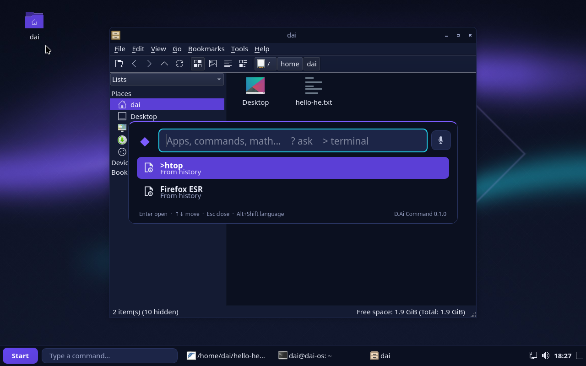
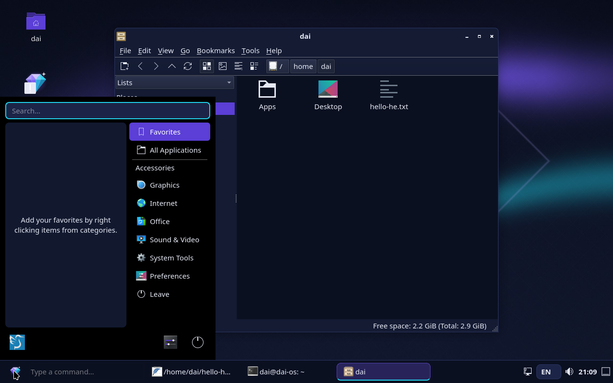
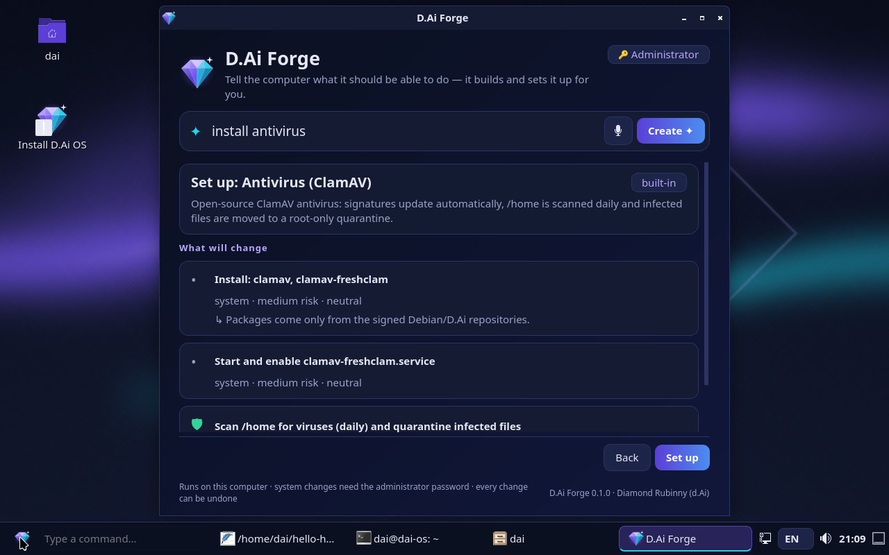
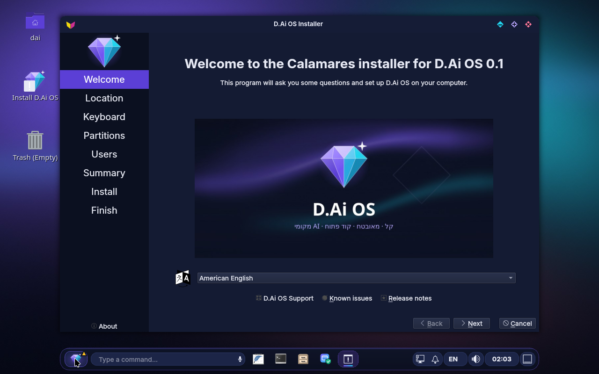
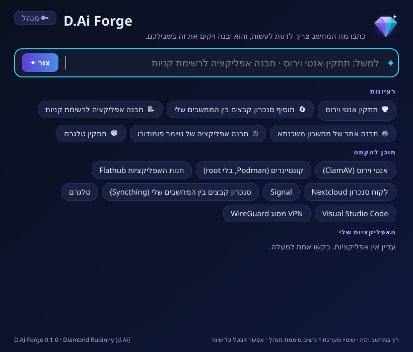
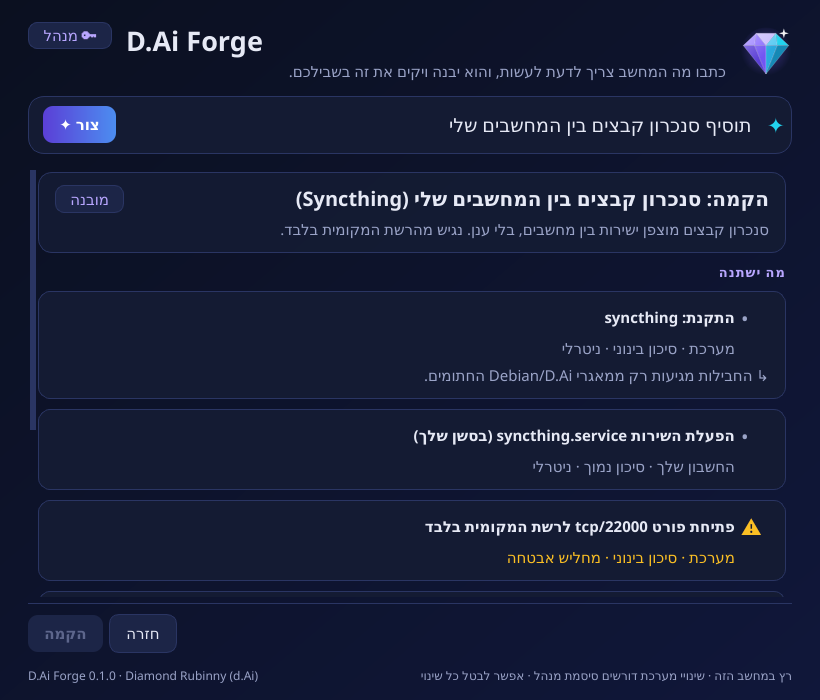
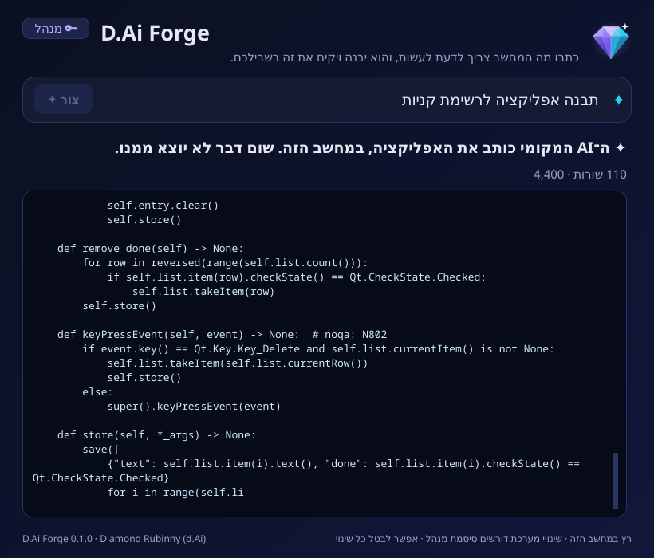

# D.Ai OS

**A lightweight, secure, open-source operating system with a built-in, fully local AI coding assistant and voice control (Whisper).**

> **מערכת הפעלה קלה, מאובטחת וקוד פתוח, עם עוזר AI מקומי לכתיבת קוד ושליטה קולית (Whisper). כל המידע נשאר במחשב ומוצפן.**

⚠️ Status: **pre-alpha** — Phase 1 (bootable base image). Not for production use.

## Goals

- **Lightweight & fast** — Debian 13 base, Wayland desktop (labwc + LXQt components), zram swap.
- **Secure by default** — AppArmor, default-deny inbound firewall (nftables), kernel hardening, automatic security updates, full-disk encryption in the installer (planned), sandboxed AI tool execution (planned).
- **Private by design** — AI and speech recognition run locally; no telemetry; no cloud AI in the default build.
- **AI built in** — `daid` system service, `dai` CLI and desktop assistant for writing, explaining and fixing code (planned, Phase 3+).
- **Voice** — push-to-talk dictation and commands with whisper.cpp, Hebrew and English (planned, Phase 5).
- **Two editions** — `user` (end users) and `dev` (developer tooling).

See the full specification and roadmap in [docs/PLAN.md](docs/PLAN.md).

## Repository layout

```
build/live-build/common/     Shared live-build config (packages, hardening, desktop defaults)
build/live-build/editions/   Edition overlays: user, dev
build/scripts/               build-iso.sh, build-debs.sh, build-apt-repo.sh, run-qemu.sh
build/keys/                  Public update-signing key and apt pinning (docs/RELEASE.md)
build/assets/                Wallpaper generator
apps/dai-command/            D.Ai Command (PyQt6) + unit tests
apps/dai-tune/               D.Ai Tune: text-driven configuration, root helper, polkit policy + unit tests
apps/dai-ai/                 Local AI: daid service, model manager, client + unit tests
apps/dai-forge/              D.Ai Forge: recipes, AI app builder, bubblewrap sandbox + unit tests
apps/dai-voice/              D.Ai Voice: push-to-talk dictation and voice commands (whisper.cpp) + unit tests
apps/dai-code/               D.Ai Code: local coding assistant + unit tests
tests/boot/                  Headless QEMU boot test
tests/apt/                   Update repository test (signature, redirect, pinning)
docs/                        Specification, architecture, threat model
```

## Building an ISO

The build must run as root in a **disposable Debian trixie** container or VM (live-build creates chroots).

```bash
docker run --rm --privileged -v "$PWD:/src" -w /src debian:trixie \
  bash build/scripts/build-iso.sh user /src/out      # or: dev
```

Output: `out/dai-os-<edition>-<version>-amd64.iso` with a `.sha256` file and a package manifest.

CI builds both editions on every change under `build/` and boots them in QEMU (`.github/workflows/build-iso.yml`). Built ISOs are available as workflow artifacts for 7 days.

D.Ai's own components are installed as Debian packages (`dai-apps`, `dai-llama-runtime`, `dai-whisper-runtime`,
`dai-panel-plugin`, built by `build/scripts/build-debs.sh`), so `dpkg` owns, verifies and can remove them.

## Releases and updates

Pushing a `v*` tag builds both editions, runs every boot test and publishes a GitHub Release with the ISOs,
`SHA256SUMS` and a signed apt repository. Installed systems get D.Ai updates from it only when the user runs
`sudo apt update && sudo apt upgrade` (Debian security updates stay automatic). Pinning allows only `dai-*`
packages from that repository, so it can never replace a Debian package. Details and the one-time key setup:
[docs/RELEASE.md](docs/RELEASE.md). Changes: [CHANGELOG.md](CHANGELOG.md).

## Testing

```bash
# Automated headless boot test (needs qemu-system-x86, xorriso, python3)
bash tests/boot/boot-test.sh out/dai-os-user-*.iso boot-artifacts

# Interactive (BIOS or UEFI)
bash build/scripts/run-qemu.sh out/dai-os-user-*.iso
bash build/scripts/run-qemu.sh out/dai-os-user-*.iso --uefi
```

Live session: user `dai`, Hebrew/English keyboard toggle with `Alt+Shift`.
Shortcuts: `Super+Space` D.Ai Command, `Super+Enter` terminal, `Super+E` files, `Super+L` lock,
`Super+←/→` snap windows, `Super+Alt+S` screen reader (Orca).

## Desktop




Inside the running image (captured by CI with real keyboard/mouse input):

| 💎 Start | D.Ai Forge from the command line | Installer (Calamares, encrypted) |
|----------|----------------------------------|----------------------------------|
|  |  |  |

D.Ai Forge (rendered from the real window code; in-VM screenshots are published by CI):

| Ask | Review the plan | The local AI writes the app |
|-----|-----------------|-----------------------------|
|  |  |  |

*Screenshots are captured automatically by CI from the live ISO booted in QEMU.*

- **Taskbar** with the **D.Ai diamond as the Start button** and, right next to it, a real **text field** (lxqt-panel plugin,
  `apps/dai-panel-plugin`) that opens D.Ai Command as you type; an **HE/EN indicator** (`dai-lang`, `Alt+Shift`).
- **D.Ai Command** (`apps/dai-command`): one bar to launch apps (also by Hebrew name), run commands
  (`>` in a terminal, `$` in the background), calculate (`2*(3+4)`, `15% of 80`) and **fix text typed in
  the wrong keyboard layout** (`akuo` → `שלום`). `?` will ask the local AI (Phase 3).
- **D.Ai Tune** (`apps/dai-tune`): configure the system by **writing what you need**, in Hebrew or English —
  `dai-tune "חסום דיסק און קי, כבה בלוטות' ונעל מסך אחרי 5 דקות"`. Text is never executed: it maps to a
  closed catalog of validated actions, shown as a plan (scope, risk, security effect) before anything changes.
  System changes go through a minimal root helper authorized by polkit, are journaled and can be undone
  (`dai-tune undo`). `dai-tune status` gives a security score with a phrase to fix each finding.
  In D.Ai Command, type `!` followed by the request. Design and threat model: [docs/TUNE.md](docs/TUNE.md).
- **Wrong-layout fixer, everywhere**: select text typed in the wrong layout in any app and press `Pause`
  (or `Super+Alt+L`) — `akuo` becomes `שלום` in place.
- **Local AI** (`apps/dai-ai`, [docs/AI.md](docs/AI.md)): llama.cpp (pinned build) served on a UNIX socket by
  the `daid` user service, which has **no network access at all** (systemd `RestrictAddressFamilies=AF_UNIX`).
  Models are downloaded on demand with `dai-models install qwen2.5-0.5b` and verified against a pinned SHA-256.
  Ask with `?` in D.Ai Command or `dai-ai "question"`; D.Ai Tune can ask it to interpret free-form requests,
  constrained to the action catalog and always confirmed by the user.
- **D.Ai Forge** (`apps/dai-forge`, [docs/FORGE.md](docs/FORGE.md)): a window (`Super+B`, or `+` in the command
  line next to the diamond Start button) where an administrator writes what the computer should be able to do — `+ תתקין אנטי וירוס`,
  `+ add file sync between my computers`, `+ תבנה אפליקציה לרשימת קניות`.
  *Recipes* (antivirus with ClamAV and quarantine, Syncthing, Flathub, Podman, WireGuard, Nextcloud, VS Code,
  Telegram, Signal) become D.Ai Tune plans: reviewed, authorized by polkit, journaled and undoable. When no recipe
  exists, the local AI writes one from catalog actions only, for review, and it can be saved and shared.
  The local AI can also **build apps** (Qt, web or terminal) that appear in the Start menu and run in a
  **bubblewrap sandbox**: no network, no access to the rest of your files, read-only system — unless you approve
  a permission. Every change keeps the previous version. Capabilities are data the user owns, so they do not
  wait for a D.Ai release.
- **D.Ai Voice** (`apps/dai-voice`, [docs/VOICE.md](docs/VOICE.md)): talk instead of typing, fully local with a
  pinned whisper.cpp. `Super+H` dictates into any app, `Super+Shift+Space` turns speech into a command for
  D.Ai Command, and the 🎙 buttons in D.Ai Command and D.Ai Forge fill the request field. Recording only starts on
  an explicit press, a notification is shown the whole time, audio lives in tmpfs and is deleted right after
  transcription, which runs in a bubblewrap sandbox without network. Models: `dai-models install whisper-small`.
- **D.Ai Code** (`apps/dai-code`, [docs/CODE.md](docs/CODE.md)): a local coding assistant for the project in the
  current folder: `dai-code ask`, `explain FILE[:A-B]`, `edit FILE "change"` (a diff to approve, a backup and
  `dai-code undo`), `review` and `commit-msg`. It never runs code, never leaves the project folder, never reads or
  edits `.env`, keys or `.git`, and redacts secrets before anything reaches the local model.
- **Installer with full-disk encryption** ([docs/INSTALL.md](docs/INSTALL.md)): Calamares with Debian's tested
  settings (LUKS via `cryptsetup`), D.Ai branding and a Hebrew slideshow; the live user and the installer are
  removed from the installed system. Start it from the desktop icon, the 💎 menu or by typing "install".
- **D.Ai Night** theme: dark, high-contrast (WCAG AA) palette with a violet→cyan accent, custom wallpaper,
  matching window decorations. Design system: [docs/DESIGN.md](docs/DESIGN.md).

## Contributing

Everyone is welcome. Read [CONTRIBUTING.md](CONTRIBUTING.md) and the [Code of Conduct](CODE_OF_CONDUCT.md).
Security issues: see [SECURITY.md](SECURITY.md) — please do not open public issues for vulnerabilities.

## Credits

D.Ai OS is created and maintained by **Diamond Rubinny (d.Ai)**.
Every source file carries an SPDX header with this copyright; see [NOTICE](NOTICE) for attribution of third-party components.

## License

D.Ai OS's own code is licensed under the [Apache License 2.0](LICENSE).
The ISO images bundle Debian packages that keep their own licenses (including `non-free-firmware` for hardware support); see each image's package manifest.

---

© 2026 Diamond Rubinny (d.Ai) · D.Ai OS · Apache-2.0
