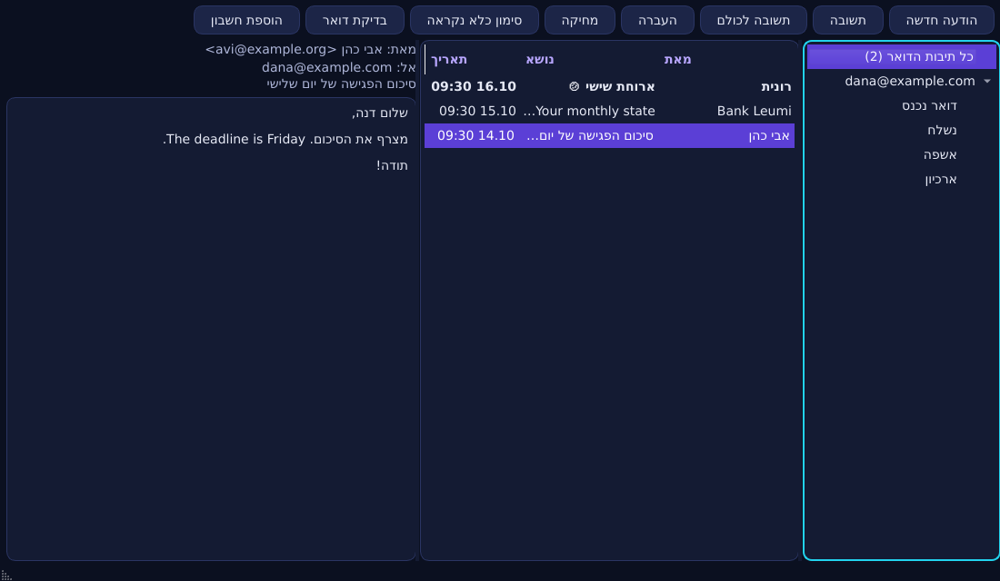
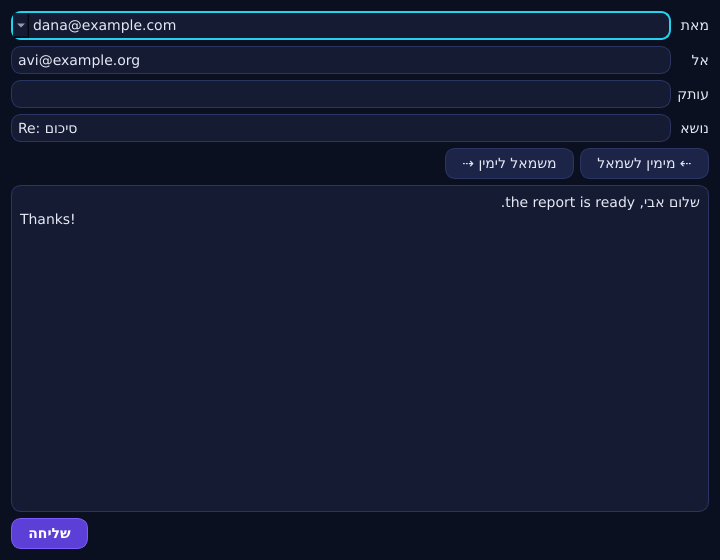

# J: לקוח הדואר של D.Ai OS

> **סטטוס:** אושר (אפשרות ב'). **שלב 1 נבנה** (§9). **משלב 2 נבנה ייבוא ההגדרות** (§10). שלבים 3–4 עוד לא התחילו.
> ⚖ = דורש בדיקה משפטית. ⚠ = דורש אימות טכני.

## 1. השם

- **"J" כשם בתוך המערכת:** בתפריט, בכותרת החלון וב"J – דואר" עובד טוב.
- **כשם ציבורי, "J" לבדו בעייתי:** אות אחת אי אפשר לחפש, אי אפשר לרשום כדומיין, וקשה להגן עליה כסימן מסחר.
- **"Jmail" לא כדאי בשום צורה:**
  - מאז נובמבר 2025 ‏jmail.world הוא אתר מוכר מאוד שמציג את המיילים של ג'פרי אפשטיין, וחיפוש של "Jmail" מוביל אליו.
  - יש גם מוצרים ישנים בשם JMail ‏(SourceForge, ‏Jalios).
  - עלול להתבלבל גם עם JMAP, פרוטוקול דואר.
- **המלצה:** **"J"** בממשק, ו־**"D.Ai J"** כשם רשמי. לא נמצאה התנגשות.
- ⚖ **לפני פרסום:** בדיקת סימני מסחר (Class 9, ‏38 ו־42) בישראל, ב־EU ובארה"ב.

## 2. למה עוד לקוח דואר: מה כואב למשתמשים היום

| # | הבעיה (מחקר) | מה J עושה |
|---|---------------|-----------|
| 1 | קורא מסך: מבנה רשימת ההודעות מבלבל, ו־JAWS/NVDA לא מקריאים חלקים (מחקר נגישות של Thunderbird, 2025) | רשימה והודעה עם **מבנה נגיש מהיום הראשון**. כל פעולה מקבלת אישור קולי, ונבדקת עם Orca |
| 2 | קיצורי מקלדת לא סטנדרטיים | קיצורים בסגנון Gmail כברירת מחדל, וכל פעולה נגישה במקלדת |
| 3 | ‏Orca ב־Linux "לא נבדק לעומק" ב־Thunderbird, ויש רגרסיות | ‏Orca הוא יעד הבדיקה העיקרי, כולל הקראה בעברית |
| 4 | **כתיבה בעברית:** אין כפתורי כיוון (באג פתוח 17 שנה), וטקסט מעורב עברית ואנגלית נשבר | **כיוון אוטומטי לכל פסקה** (`dir=auto`), כפתורי ימין ושמאל, ובידוד של שמות וכתובות באנגלית |
| 5 | נושאים בעברית מיושרים הפוך, ואותיות הפוכות (KMail, ‏eM Client, ‏Outlook mobile) | יישור לפי השפה בכל מקום: רשימה, נושא וכותרות |
| 6 | פיסוק וסמן שבורים בטקסט מעורב | עורך עם בידוד bidi נכון, ובדיקות אוטומטיות על משפטים מעורבים |
| 7 | הגדלת גופן וניגודיות לא אחידים | גודל אחד ממוצג לפי הגדרת המערכת, ומצב ניגודיות גבוהה |
| 8 | **הגדרת חשבון מסובכת** (פורטים, POP/IMAP, ‏OAuth ששובר) | **כתובת מייל וזהו:** גילוי אוטומטי של השרתים (סעיף 3.2), בלי פורטים ובלי מונחים |
| 9 | תיבה מאוחדת לכמה חשבונות | תיבה מאוחדת כברירת מחדל |
| 10 | נודניק ("הזכר לי מחר") | נודניק מקומי |
| 11 | ביטול שליחה | "ביטול שליחה" ל־10 שניות, ואפשר לשנות |
| 12 | חיפוש, ספאם ושרשורים | חיפוש מקומי מהיר (SQLite FTS5), שרשורים, ודיווח ספאם לשרת |

## 3. ייבוא הגדרות מלקוחות קיימים

### 3.1 מה אפשר למשוך, ומאיפה

| מקור | מה מיובא | מה לא, ולמה |
|------|----------|-------------|
| **Thunderbird / Betterbird** | חשבונות, שרתים וזהויות (`prefs.js`), דואר מקומי (mbox), אנשי קשר (`abook.sqlite`) ומסננים | **סיסמאות:** רק בהסכמה. אם יש סיסמה ראשית, המשתמש מקליד אותה. **‏OAuth:** כניסה מחדש, כי ה־token שייך ל־Thunderbird |
| **Evolution** | חשבונות (`~/.config/evolution/sources/*.source`) ודואר מקומי (Maildir) ⚠ | סיסמאות דרך keyring, באישור המשתמש |
| **KMail** | דרך PIM Data Exporter, או קריאה של `kmailrc`/`emailidentities` ⚠ | ‏IMAP יורד מחדש. סיסמאות ב־KWallet |
| **Geary** | ‏`geary.ini` ⚠ | חשבונות Gmail/Microsoft נמצאים ב־GNOME Online Accounts |
| **Claws Mail** | ‏`accountrc`, דואר (MH) ואנשי קשר (XML) | סיסמאות מוצפנות ⚠ |
| **Mutt / NeoMutt** | ניחוש מתוך `muttrc` (משתמש, שרתים ותיקיות) | סיסמאות (gpg/pass) |
| **Outlook (Windows)** | **קובצי PST** מתוך כונן Windows, דרך `readpst` ‏(pst-utils, ב־Debian). ההמרה ל־mbox משתלבת ב־D.Ai Move הקיים | הגדרות וסיסמאות (רישום ו־DPAPI של Windows). החשבון נבנה מחדש מהכתובת בלבד |
| **Apple Mail** | ייצוא mbox מה־Mac | הגדרות החשבון |
| **Gmail, ‏Outlook.com ו־Yahoo (אתר)** | אין מה לייבא מקבצים. הכתובת, גילוי אוטומטי וכניסת OAuth. אפשר גם לייבא Google Takeout ‏(mbox) | — |

- **עקרון:** שום ייבוא לא מוחק או משנה את הלקוח הישן. הוא רק קורא ממנו.
- **סיסמאות לא מיובאות בשקט אף פעם.** המשתמש רואה מה יובא ומאשר.

### 3.2 הגדרת חשבון מכתובת בלבד

1. **Mozilla autoconfig** (גם הדומיין עצמו וגם ה־ISPDB הציבורי).
2. רשומות SRV לפי RFC 6186 ו־8314.
3. ‏MX: זיהוי Google Workspace או Microsoft 365 בדומיין פרטי.
4. ‏Microsoft Autodiscover.
5. ניחוש זהיר: ‏`imap.`/`smtp.` בפורטים 993, 465 ו־587. **רק עם TLS.**

### 3.3 ‏OAuth: הסיכון העיקרי בלוח הזמנים

- לכל לקוח צריך **מזהה OAuth משלו**. אסור להשתמש במזהים של Thunderbird.
- **Google:** ‏IMAP דורש את ה־scope ‏`https://mail.google.com/`, שמוגדר **restricted**.
  - **אימות אפליקציה** אצל Google לוקח שבועות.
  - ⚖⚠ ייתכן שתידרש גם **הערכת אבטחה שנתית (CASA) בתשלום**. Google לא אומרת במפורש שלקוח מקומי בלבד פטור, ולכן **צריך אישור בכתב מ־Google**.
  - **בינתיים:** סיסמת אפליקציה ("App password") עובדת עם אימות דו־שלבי.
- **Microsoft:** רישום אפליקציה ציבורית ב־Entra ID, ‏IMAP/SMTP עם PKCE. ⚠ ייתכנו חסימות של מנהלי ארגונים.
- **המלצה:** להתחיל את תהליך האימות מול Google ו־Microsoft **מיד** אם התוכנית מאושרת, במקביל לפיתוח.

## 4. החלטה טכנית

| אפשרות | יתרונות | חסרונות | הערכה |
|---------|---------|---------|--------|
| א. ‏Thunderbird + הגדרות D.Ai (כמו Ruby) | בוגר, כולל OAuth מאומת של Mozilla | אי אפשר לקרוא לו J. בעיות העברית וה־Orca (1–6) נשארות. ‏Gecko גדול מכדי להתאים אותו | **פתרון ביניים** עד ש־J מוכן |
| **ב. ‏J משלנו ב־PyQt6** | שליטה מלאה ב־RTL ובנגישות. אותה מערכת עיצוב, עברית, Diamond ‏(AI מקומי) | אנחנו אחראים על מקרי הקצה של IMAP, על OAuth ועל הקשחה | ✅ **מומלץ** |
| ג. פורק של Geary | קוד בוגר | ‏GTK ו־Vala לא מתאימים לשולחן ה־Qt. ‏OAuth תלוי ב־GNOME | לא |

**ארכיטקטורה (ב):**
- ‏`imapclient` ‏(BSD) ו־`smtplib`.
- אחסון: Maildir מקומי + אינדקס SQLite FTS5 לחיפוש.
- סיסמאות: Secret Service דרך QtKeychain. **אף פעם לא בקובץ גלוי.**
- כל פעולה ברקע: IDLE לדואר נכנס, בלי polling כבד.

## 5. אבטחה ופרטיות

- **תוכן מרוחק חסום כברירת מחדל:** אין פיקסלי מעקב. אפשר להתיר לפי שולח.
- **‏HTML:**
  - ניקוי עם רשימת היתר (allow-list) לפני תצוגה.
  - תצוגה בלי JavaScript, בלי טעינות מרוחקות, עם CSP קשיח ופרופיל נפרד.
  - **מצב טקסט** בלחיצה.
- **הצפנה (OpenPGP ו־S/MIME, שלב מאוחר):**
  - לפי לקחי EFAIL, תוכן מפוענח לא טוען כלום מרחוק, וחלקי ה־MIME מבודדים.
  - ‏GnuPG ‏(gpgme).
- **Diamond (AI מקומי), רק בלחיצה:**
  - "סכם שרשור", "כתוב תשובה", "מה מבקשים ממני?".
  - הטקסט נכנס ל־AI **כנתונים בלבד**, והגנה מ־prompt injection בהודעות: ה־AI לא מבצע פעולות, רק מציע טקסט.
  - שום דבר לא יוצא מהמחשב.
- **אין טלמטריה ואין חשבון D.Ai.** שרת היחיד שמדברים איתו הוא שרת הדואר של המשתמש.
- **מידע אישי:** הדואר ואנשי הקשר נשמרים מקומית בלבד, תחת `~/.local/share/dai-j` ‏(0700), ובדיסק מוצפן כשהמשתמש בחר בהצפנה בהתקנה.
- **מחיקה:** "הסר חשבון" מוחק את המטמון המקומי שלו ואת הסיסמה מה־keyring.

## 6. נגישות (WCAG 2.1 AA)

- **מקלדת:** ניווט מלא, עם סדר פוקוס הגיוני.
- **קורא מסך:** שמות ותפקידים נגישים לכל רכיב. השורה ברשימה מוקראת כ"שולח, נושא, תאריך, נקרא/לא נקרא".
- **תצוגה:** ניגודיות AA, הגדלה עד 200%, ומצב ניגודיות גבוהה.
- **עברית:** כיוון אוטומטי בכל שדה. ‏Orca עם קול עברי (eSpeak-NG) כחלק מהבדיקות.

## 7. שלבים

| שלב | מה |
|-----|----|
| 1 | חשבון מכתובת (autoconfig, ‏SRV ו־MX) + IMAP/SMTP עם סיסמה או סיסמת אפליקציה, תיבה מאוחדת, קריאה וכתיבה, עברית ו־RTL, נגישות |
| 2 | **ייבוא:** ‏Thunderbird, ‏Evolution, ‏Claws, ‏Mutt ו־KMail, ו־PST דרך D.Ai Move |
| 3 | ‏OAuth ל־Google ו־Microsoft (אחרי האימות), חיפוש, נודניק, ביטול שליחה וחסימת מעקב |
| 4 | ‏Diamond, ‏OpenPGP ו־S/MIME |

**בינתיים:** מתכון Forge "Thunderbird עם הגדרות D.Ai", למי שצריך דואר היום.

## 8. החלטות (אושרו)

1. **אפשרות ב:** ‏J משלנו ב־PyQt6, עם Thunderbird כפתרון ביניים. ✅ (מתכון Forge: ‏`+ thunderbird`)
2. **השם:** ‏"J" בממשק ו־"D.Ai J" כשם רשמי. **בלי "Jmail".** ✅
3. **‏OAuth:** ⏳ **ממתין לך.** לפתוח תהליך אימות מול Google ו־Microsoft דורש חשבון מפתח על שם הפרויקט. עד אז: Gmail עם סיסמת אפליקציה, ו־Microsoft דרך Thunderbird.

## 9. שלב 1: מה נבנה (`apps/dai-j/`)

| קובץ | מה |
|------|----|
| `discover.py` | חשבון מכתובת בלבד, לפי הסדר: ספקים מוכרים (Gmail, ‏Yahoo, ‏iCloud ו־Microsoft, בלי רשת), ‏autoconfig של הספק (**HTTPS בלבד**), ‏ISPDB של Mozilla, ‏SRV ‏(RFC 6186/8314), ‏MX (Google Workspace, ‏Microsoft 365), וניחוש זהיר. **שרת בלי הצפנה לא נבחר אף פעם.** שמות שרתים עוברים בדיקת תקינות, ותשובה מוגבלת ל־64KB |
| `mail.py` | ‏IMAP ו־SMTP עם TLS בלבד (TLS 1.2 ומעלה, ובדיקת תעודה של המערכת), חיבור קצר לכל משימה, ‏modified UTF-7 לשמות תיקיות בעברית, זיהוי תיקיות לפי SPECIAL-USE או לפי שמות מוכרים (גם בעברית), ‏MOVE עם נפילה ל־COPY+EXPUNGE |
| `store.py` | עותק מקומי ב־SQLite ‏(0600, בתיקייה 0700) עם `secure_delete`. כותרות לכל התיקיות הראשיות, וגוף ההודעה נשמר רק אחרי שנפתח. ‏UIDVALIDITY שהשתנה מרוקן את התיקייה. "הסרת חשבון" מוחקת את כל השורות שלו (ו־VACUUM) |
| `accounts.py` | רשימת החשבונות **בלי סיסמאות** ‏(0600). הסיסמה נשמרת במחזיק המפתחות (Secret Service דרך `secret-tool`, ‏**דרך stdin** ולא בשורת הפקודה). בלי מחזיק מפתחות: בזיכרון בלבד, עד הסגירה |
| `sanitize.py` | ‏HTML נבנה מחדש מרשימת היתר. אין סקריפטים, סגנונות, טפסים או מסגרות. **תמונות מרוחקות חסומות** (פיקסלי מעקב), ויש הודעה כמה נחסמו. קישורים רק ל־http, ‏https ו־mailto, וה־tooltip מציג לאן הם באמת מובילים. ‏`dir="auto"` לכל פסקה |
| `compose.py` | **כל פסקה שומרת על הכיוון שלה:** טקסט רגיל + חלופת HTML עם `dir` לכל פסקה, כך שעברית ואנגלית מגיעות נכון לכל לקוח. תשובה, תשובה לכולם (בלי עצמי), העברה, ובדיקת כתובות |
| `gui.py` | שלוש עמודות: תיקיות, הודעות והודעה. **תיבה מאוחדת** עם מונה של הודעות שלא נקראו. קיצורים: ‏Ctrl+N/R ‏Shift+R/F, ‏Delete, ‏F5, ובתוך הרשימה המקשים של Gmail ‏(c, ‏r, ‏a, ‏f, ‏#, ‏j, ‏k, ‏u). קורא מסך שומע "שולח, נושא, תאריך, לא נקראה". כפתורי "מימין לשמאל" ו"משמאל לימין" לפסקה (Ctrl+Shift+R / Ctrl+Shift+L). בדיקה כל 3 דקות ברקע, ושליחה כפולה חסומה |
| `cli.py` | ‏`dai-j`, ‏`dai-j mailto:…` ‏(J הוא ברירת המחדל לקישורי mailto), ‏`dai-j discover ADDRESS` |

*(צילום מהבדיקות, offscreen. צילום מתוך המערכת יתווסף בשלב הבא.)*

**בדיקות:**
- **יחידה (25):** גילוי (ספקים, ‏ISPDB, ‏SRV, ‏MX, ניחוש, ‏XML זדוני), מחזיק המפתחות (הסיסמה לא ב־argv), קובץ החשבונות, הניקוי (סקריפט, פיקסל, ‏`javascript:`, טפסים וטקסט מוסתר), כיווניות בכתיבה, ו־**‏imaplib אמיתי מול שרת IMAP מקומי בבדיקה**: סנכרון, תיקייה בעברית, קריאה, מחיקה לאשפה, שינויים מהשרת, ‏UIDVALIDITY, סיסמה שגויה, שליחה עם עותק ב"נשלח", וסירוב לחיבור לא מוצפן ולנפילה מ־TLS. גם החלונות נבדקים.
- **‏VM:** ‏`j: mail client`: ‏`dai-j discover` מוצא את Gmail, ‏`secret-tool` ו־Secret Service קיימים, ‏J מוגדר ל־mailto, והמודולים נטענים.

**⚠ עוד לאמת:**
- ש־gnome-keyring נפתח אוטומטית בכניסה עם SDDM (‏`libpam-gnome-keyring`). אם לא, בפעם הראשונה תופיע בקשה ליצור סיסמה למחזיק המפתחות.
- **‏Microsoft (Outlook.com, ‏Hotmail ו־365)** מקבלים רק OAuth. ‏J מסביר זאת ומפנה ל־Thunderbird עד שלב 3.

## 10. שלב 2 (חלק א'): ייבוא הגדרות מתוכנות הדואר הקיימות (נבנה)

‏`apps/dai-j/dai_j/importers.py`, ‏`dai-j import [--add]`, והכפתור **"ייבוא מתוכנת דואר אחרת"** במסך הפתיחה ובסרגל.

| מקור | מה נקרא |
|------|---------|
| ‏**Thunderbird / Betterbird** (גם Flatpak ו־Snap) | ‏`prefs.js` של כל פרופיל: חשבונות IMAP, זהות (כתובת ושם), שרת IMAP ו־SMTP, פורטים, הצפנה ושם משתמש |
| ‏**Evolution** | ‏`~/.config/evolution/sources/*.source`: חשבון, זהות ושרת שליחה, מקושרים לפי UID |
| ‏**Claws Mail** ⚠ | ‏`accountrc`: חשבונות IMAP. הפורמט לפי התיעוד, ולא נבדק עדיין מול התקנה אמיתית |
| ‏**Mutt / NeoMutt** | ‏`muttrc`: ‏`from`, ‏`folder` (‏imaps://) ו־`smtp_url` |

- **לקריאה בלבד.** התוכנה האחרת לא משתנה (גם ב־VM: ‏md5 של `prefs.js` לפני ואחרי).
- **סיסמאות לא מיובאות** (גם `logins.json` של Thunderbird לא נקרא). ‏J מבקש כל סיסמה בכניסה הראשונה.
- **חשבון שהשתמש בחיבור לא מוצפן** מוצג אבל לא ניתן לסימון. חשבון שנכנס רק ב־OAuth (Thunderbird ‏`authMethod=10`) מוצג עם הסבר.
- **⏳ עוד לא:** KMail ו־Geary, ייבוא של הדואר עצמו (mbox, Maildir, ‏PST דרך readpst), אנשי קשר ומסננים. יגיעו בחלק ב' של שלב 2, יחד עם תיקיות מקומיות ב־J.
- **תוקן גם:** כפתור "הודעה חדשה" בסרגל העביר את מצב הכפתור (False) כאילו היה כתובת mailto, ופתיחת הכתיבה נכשלה. נוספה בדיקה.

---

© 2026 Diamond Rubinny (d.Ai) · D.Ai OS · Apache-2.0
