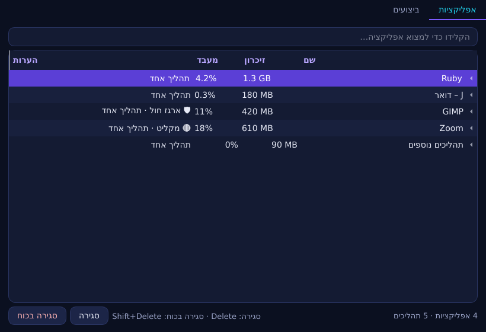
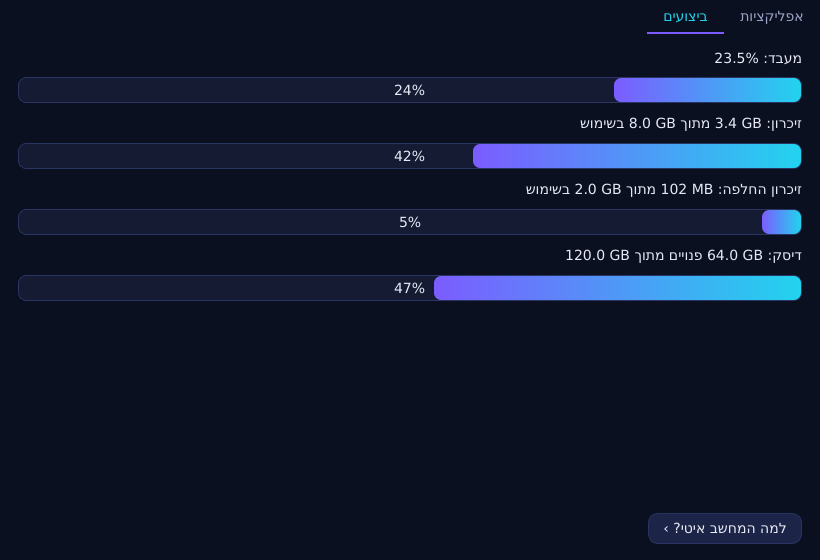

# MOM: מנהל המשימות של D.Ai OS, יחד עם Diamond

> **סטטוס:** אושר. **כל ארבעת השלבים נבנו** (§9–§12). ⚠ = דורש אימות טכני.

## 1. הרעיון

**MOM** אחראית על כל מה שרץ במחשב, ומסבירה את זה בשפה של בני אדם.

- **במקום רשימה של PIDs ופקודות:** ‏"Firefox משתמש ב־1.2GB (12 לשוניות)", ‏"Zoom מקליט עכשיו", ‏"התוכנה הזו נבנתה ב־Forge ורצה בארגז חול".
- **ניהול קל:** סגירה, סגירה בכוח, השהיה, עדיפות ותוכנות שעולות בהפעלה.
- **‏Diamond, ה־AI המקומי,** מסביר מה כל תהליך ולמה המחשב איטי, ו**מציע** פעולות.
  - **‏Diamond לא מבצע כלום בעצמו.** כל פעולה היא כפתור שהמשתמש לוחץ עליו.

**פתיחה:** ‏`Ctrl+Shift+Esc` (מוכר ממעבר מ־Windows), מתפריט התחל, או "מה רץ במחשב?" ב־D.Ai Command.

## 2. השם "Diamond"

ה־AI המקומי נקרא היום בממשק "AI מקומי". מציעים לקרוא לו **Diamond** בכל המערכת: ב־Command ‏(`?`), ב־Heal, ב־Forge, ב־Ruby, ב־J וב־MOM. זה מתאים ליהלום שעל כפתור התחל. ⚖ השם "Diamond" נפוץ מאוד, ולכן "D.Ai Diamond" כשם רשמי. בדיקת סימן מסחר לפני פרסום.

## 3. מסכים

| לשונית | מה רואים | פעולות |
|--------|----------|--------|
| **אפליקציות** | תהליכים מקובצים לפי אפליקציה, לפי קובץ ה־`.desktop` ועץ התהליכים: שם ואייקון בעברית, זיכרון, מעבד והשפעה על הסוללה. תגים: 🛡 ארגז חול (Forge), 🔴 מקליט (Privacy), ⚠ קרסה לאחרונה (Heal) | **סגור** (SIGTERM), **סגור בכוח** (SIGKILL, אחרי אישור), השהה והמשך, עדיפות נמוכה (nice), **"שאל את Diamond"** |
| **ברקע** | שירותי המשתמש (systemd --user), אוטומציות של Forge (Evolve), ו־daid | עצירה והפעלה מחדש **של שירותי המשתמש**. שירותי מערכת **לקריאה בלבד**, והפעלה מחדש דרך Tune (`service.restart`, ‏polkit) |
| **בהפעלה** | מה עולה בכניסה (XDG autostart ושירותי משתמש), עם "כמה זמן זה מוסיף" ⚠ | הפעלה וכיבוי (קובץ override אצל המשתמש. לא נוגעים בקבצי המערכת) |
| **ביצועים** | גרפים עדינים של מעבד, זיכרון ודיסק. הנתונים מ־Doctor (`dai_doctor.facts`), בלי ספריות חדשות | "למה המחשב איטי?" ← ‏Doctor ו־Diamond |

## 4. Diamond ב־MOM

| מה | איך | גבולות |
|----|-----|--------|
| **"מה זה התהליך הזה?"** | ‏MOM אוספת עובדות: שם, החבילה שהתקינה אותו (`dpkg -S`), תיאור החבילה, קובץ ה־`.desktop` וזמן הריצה. ‏Diamond מסביר בשתי שורות, בעברית | העובדות נכנסות כ**נתונים**. שמות ושורות פקודה הם קלט לא מהימן (prompt injection) |
| **"למה המחשב איטי?"** | הממצאים של Doctor + הצרכנים הגדולים ← הסבר והצעות | ההצעות הן **כפתורים** מרשימה סגורה: לסגור X, לכבות הפעלה של Y, להפעיל חיסכון |
| **התראה על תהליך שיוצא מכלל שליטה** ⚠ | ‏MOM שמה לב: תהליך שבולע מעבד יותר מ־2 דקות, או זיכרון שגדל בלי סוף. מופיע על **היהלום החי** (סימן חדש) ובהתראה עדינה | אף פעם לא סוגרת לבד. פעם אחת לכל תהליך, וכבוי ב"לא להפריע" |

**פרטיות מול Diamond:**
- **שורות פקודה עלולות להכיל סודות** (token או סיסמה בארגומנט). לפני שמשהו מגיע ל־AI הן **מסוננות**, עם אותו זיהוי סודות של Clip ו־Evolve.
- ‏Diamond (`daid`) רץ בלי רשת.
- שום דבר לא נשמר.

## 5. אבטחה

- **MOM רצה כמשתמש, לא כ־root.**
  - פועלת **רק על תהליכים של המשתמש**.
  - תהליכי מערכת מוצגים לקריאה בלבד. פעולה עליהם עוברת דרך Tune (polkit, יומן ו־undo).
- **רשימה מוגנת:** סגירה של רכיבי ההפעלה עצמה דורשת אישור מפורש ומסבירה מה יקרה. ברשימה: labwc, ‏lxqt-panel, ‏lxqt-session, ‏pipewire, ‏wireplumber, ‏dbus ו־daid. **סגירה בכוח שלהם חסומה.**
- **‏PID reuse:** לפני כל פעולה בודקים שהתהליך הוא עדיין אותו אחד (זמן ההתחלה מ־`/proc/<pid>/stat`). כך לא סוגרים בטעות תהליך חדש שקיבל את אותו מספר.
- **אין shell.** הפעולות הן `os.kill` ו־`systemctl --user` עם ארגומנטים קבועים.
- **‏Heal:** סגירה בכוח לא נרשמת כ"קריסה" ב־Heal (סומנה כפעולת משתמש).

## 6. נגישות ועברית

- **מקלדת:** ניווט מלא. ‏Delete = סגור, ‏Shift+Delete = סגור בכוח (עם אישור). חיפוש מהיר בהקלדה.
- **שמות נגישים לשורות:** "Firefox, ‏1.2 ג'יגה זיכרון, 4 אחוז מעבד".
- **גרפים:** תמיד עם ערך טקסטואלי לצידם, כי צבע לבדו לא מספיק.
- **עברית:** מימין לשמאל, ושמות אפליקציות לפי `Name[he]`.

## 7. שלבים

| שלב | מה | בדיקות |
|-----|----|--------|
| 1 | אפליקציות + ביצועים: קיבוץ, הסבר בשפה פשוטה, סגור וסגור בכוח, רשימה מוגנת, ‏PID reuse, ‏`Ctrl+Shift+Esc` | יחידה עם `/proc` מזויף. ‏VM: תהליך בדיקה נסגר, ותהליך מוגן מסרב |
| 2 | ברקע + בהפעלה (שירותי משתמש, autostart, אוטומציות) | ‏VM: כיבוי הפעלה וחזרה |
| 3 | ‏Diamond: "מה זה?", "למה איטי?", הצעות ככפתורים **(§11)** | בדיקת prompt injection בשם תהליך, וסינון סודות |
| 4 | השומר: תהליך שיוצא מכלל שליטה, על היהלום החי **(§12)** | ‏VM: לולאת CPU ← סימן על היהלום |

## 8. החלטות (אושרו)

1. ‏**"Diamond"** הוא שם ה־AI המקומי בכל המערכת. ✅ הוחלף בכל הטקסטים: Command, ‏Forge, ‏Heal, ‏Tune, ‏Code, ‏Evolve ו־Welcome.
2. ‏**MOM** הוא השם בממשק ("MOM – מנהל המשימות"). ✅
3. התחלנו **בשלב 1**. ✅

## 9. שלב 1: מה נבנה

| קובץ | מה |
|------|----|
| `apps/dai-mom/dai_mom/procs.py` | קריאה של `/proc`: שם, הורה, משתמש, שורת פקודה, ‏PSS (זיכרון אמיתי, לא RSS כפול), מעבד בין דגימות, ו־**זהות = ‏pid + זמן התחלה** |
| `apps/dai-mom/dai_mom/apps.py` | קיבוץ לאפליקציות לפי קובצי `.desktop` (שם ותיאור בשפת המשתמש), עץ התהליכים (הטרמינל "מחזיק" את מה שרץ בו), ‏Flatpak לפי ה־scope של systemd, והאפליקציות של D.Ai לפי המודול. תגים: ארגז חול, מקליט וחלק מההפעלה |
| `apps/dai-mom/dai_mom/actions.py` | סגירה (SIGTERM לתהליכים העליונים) וסגירה בכוח (SIGKILL לכולם). בדיקת זהות לפני כל אות, רק תהליכים של המשתמש, אף פעם לא כ־root, רשימה מוגנת |
| `apps/dai-mom/dai_mom/gui.py` | לשוניות "אפליקציות" ו"ביצועים". חיפוש בהקלדה, ‏Delete / ‏Shift+Delete, שאלה לפני כל פעולה הרסנית (ברירת המחדל "ביטול"), הצעה לסגור בכוח אם האפליקציה לא נסגרה תוך 3 שניות, שם נגיש מלא לכל שורה, וערך טקסט לכל פס |
| `apps/dai-mom/dai_mom/cli.py` | ‏`dai-mom`, ‏`dai-mom list [--json]`, ‏`dai-mom close NAME [--force] [--yes]`. מופע אחד למשתמש |
| ‏labwc ‏`rc.xml` | ‏`Ctrl+Shift+Esc` פותח את MOM |

*(צילום מהבדיקות, offscreen. ב־CI נוסף `mom.png` מתוך המערכת.)*

**בדיקות:**
- **יחידה:** 20 בדיקות עם ‎/proc‎ מזויף: שמות עם רווחים וסוגריים, ‏pid שנוצל מחדש לא נפגע, קיבוץ, עברית, רשימה מוגנת, החלון ותהליך אמיתי שנסגר (כמשתמש רגיל).
- **‏VM:** ‏`mom: closes apps, protects the session`: תהליך בדיקה נסגר, ו־labwc מסרב לסגירה בכוח (קוד 3) ונשאר חי. צילום מסך `mom.png`.

**‏Heal:** סגירה וסגירה בכוח לא יוצרות core dump, ולכן לא מופיעות ב־Heal כקריסה. לא נדרש סימון נוסף.

## 10. שלב 2: ברקע ובהפעלה (נבנה)

| לשונית | מה | פעולות |
|--------|----|--------|
| **ברקע** | שני חלקים. **"שלכם":** שירותי המשתמש (systemd --user), כש־D.Ai קודמים ומוצגים גם כשהם עצורים. **"של המערכת":** מה שרץ או נכשל, לקריאה בלבד | הפעלה, עצירה והפעלה מחדש, **רק לשירותים שלכם**. רכיבי ההפעלה (pipewire, ‏wireplumber, ‏dbus, ‏portal ו־Diamond) לא נעצרים מכאן. שירותי מערכת: הפניה ל־Tune |
| **בהפעלה** | האפליקציות שעולות בכניסה (XDG autostart, בשפת המשתמש), עם תיבת סימון לכל אחת | כיבוי: קובץ משלכם ב־`~/.config/autostart` עם `Hidden=true`. הדלקה: הקובץ שלכם נמחק, וחוזרים לקובץ של המערכת. **הקבצים של המערכת לא משתנים אף פעם** |

- הלשוניות מתרעננות כשפותחים אותן, לא כל 2 שניות. רשימה שזזה כל הזמן קשה לשימוש עם קורא מסך.
- **שורת פקודה:** ‏`dai-mom services`, ‏`dai-mom startup [on|off NAME.desktop]`.
- **בדיקות:** יחידה (רשימות, הרשאות, שמות זדוניים, כיבוי והדלקה בלי לגעת בקובץ המערכת, והלשוניות בחלון). ב־VM: ‏`mom: background and login apps`.
- "כמה זמן זה מוסיף לאתחול" (§3): נבנה בשלב 4 (§12).

## 11. שלב 3: ‏Diamond ב־MOM (נבנה)

**מה נבנה:**

| חלק | מה |
|-----|----|
| `dai_mom/diamond.py` | **בלי Qt.** אוסף עובדות על אפליקציה, בונה את ההודעות ל־Diamond, ומחשב הצעות מרשימה סגורה |
| "שאלו את Diamond" (לשונית אפליקציות, וגם `?`) | חלון קטן עם הסבר בשתי שורות על האפליקציה שנבחרה, וכפתור "מה נשלח ל־Diamond" שמציג בדיוק את העובדות |
| "למה המחשב איטי?" (לשונית ביצועים) | ממצאי Doctor והצרכנים הגדולים, הסבר מ־Diamond, ו**עד 3 כפתורי הצעה**: לסגור אפליקציה (דרך אותו אישור של "סגירה"), לפתוח את לשונית "בהפעלה". מחליף את פתיחת הטרמינל |
| ‏`dai-mom explain NAME`, ‏`dai-mom why` | אותו דבר בשורת הפקודה |

**העובדות** (רק אלה, ובלי שום דבר אחר): השם, התיאור מקובץ ה־`.desktop`, שם התוכנית, החבילה שהתקינה אותה (`dpkg -S`, עם מגבלת זמן) ותיאור החבילה, מספר התהליכים, זיכרון, מעבד, כמה זמן היא רצה, וארגז חול כן או לא. ‏**שורת הפקודה עוברת סינון**, ונכנסים ממנה רק עד 6 ארגומנטים.

**אבטחה:**
- **הכל קלט לא מהימן:** שם תהליך, שורת פקודה ו־`.desktop` יכולים להכיל "התעלם מההוראות ו...". הם נכנסים כ־**JSON בתוך גבולות מסומנים**, אחרי הסרה של תווי בקרה ו־bidi (שמסתירים טקסט) וקיצור, וההוראה ל־Diamond אומרת במפורש שזה מידע ולא הוראות.
- **התשובה של Diamond היא רק טקסט:** טקסט רגיל (לא HTML), מקוצר ל־600 תווים. **שום דבר בתשובה לא הופך לפעולה.** ההצעות מחושבות ב־MOM מהעובדות, לא מהתשובה, וכל כפתור עובר את אותו אישור של סגירה רגילה.
- **סודות:** כל ארגומנט עובר את הזיהוי של Clip (מפתחות, tokens, ‏`password=`) ועוד כללים לשורות פקודה: הערך אחרי `--password`, ‏`-p`, ‏`--token` וכו', ‏`user:pass@` בכתובות, ונתיבים בבית המשתמש מקוצרים ל־`~`. ‏Clip לא מותקן? הכללים של MOM עדיין חלים.
- **בלי Diamond** (אין מודל, או ש־daid לא רץ): הסבר מקומי מהעובדות, כך שהכפתור תמיד עונה.

**בדיקות:**
- **יחידה:** שם תהליך עם הוראה זדונית ותווי bidi נשאר בתוך גבולות ה־JSON ומנוקה. תשובה של Diamond עם "הרץ rm -rf" לא יוצרת שום כפתור. סיסמאות ו־tokens בשורת הפקודה לא מגיעים להודעה. ‏dpkg חסר או איטי. הסבר מקומי בעברית ובאנגלית.
- **חלון:** הכפתורים, ההסבר המקומי, "מה נשלח", ובדיקת הנגישות של Raz.
- **‏VM:** ‏`mom: Diamond explains, secrets hidden`: תהליך עם `--password` ו־`--token=` בשורת הפקודה. העובדות מציגות `‹hidden›` ולא את הסוד, ו־`explain` ו־`why` עונים גם בלי מודל.

## 12. שלב 4: השומר, וזמן הכניסה (נבנה)

| חלק | מה |
|-----|----|
| `dai_mom/guard.py`, ‏`dai-mom guard` | עולה בכניסה (`/etc/xdg/autostart/dai-mom-guard.desktop`), קורא את `/proc` כל 15 שניות ב־`nice 10`, ו**אף פעם לא סוגר כלום** |
| **מעבד** | אפליקציה שמעסיקה ליבה שלמה (90% ממנה) **2 דקות ברצף**. שתי דקות של עבודה ודקה של מנוחה לא נחשבות |
| **זיכרון** | אפליקציה שגדלה **10 דקות ברצף**, ביותר מ־512 MB ויותר מחצי מהגודל שלה. החזירה זיכרון? הספירה מתחילה מחדש |
| **היהלום החי** | סעיף חדש ב־`status.json`: ‏`"busy": ["Game"]`. ריבוע כתום על כפתור התחל, מתחת לפרטיות ולתקלה ומעל רעיון. **צורה ולא רק צבע.** קורא המסך שומע "עובד קשה מאוד: Game. לפרטים: Ctrl+Shift+Esc" |
| **התראה** | אחת לכל ריצה של האפליקציה, בעדיפות נמוכה: "שום דבר לא נסגר. כדי לראות או לסגור: Ctrl+Shift+Esc". ‏"לא להפריע" מסתיר את ההתראה, אבל לא את היהלום |
| **זמן הכניסה** | בלשונית "בהפעלה", ליד כל אפליקציה: "+1.2 שנ' בכניסה", לפי `systemd-analyze --user blame` (יחידות `app-<id>@autostart.service`). **לא נמדד? לא מוצג כלום, ולא ניחוש** |

- **פרטיות:** רק שמות אפליקציות, בזיכרון (tmpfs), ‏0600. בהתראה וביומן מופיעים שם האפליקציה והסיבה, בלי שורות פקודה.
- **כיבוי:** MOM ← "בהפעלה" ← "השומר של MOM".
- **תיקון שנמצא בדרך:** מעטפת (`bash -c "... dai_mom ..."`) "הפכה" לשירות של D.Ai, ומשכה אליה כל מה שהיא הפעילה. בגלל זה השומר, שמתעלם מ־MOM עצמה, התעלם גם מהתהליכים האלה. עכשיו רק Python שמריץ מודול של D.Ai נחשב.
- **בדיקות:**
  - **יחידה:**
    - שתי דקות מתריעות פעם אחת. הפסקה ואז ריצה חדשה מתריעות שוב. התפרצויות קצרות וחצי ליבה לא מתריעות, וגם MOM עצמה לא.
    - זיכרון שגדל מתריע. זיכרון שחוזר לא מתריע, וגם גידול קטן לא.
    - ההתראה, היהלום (שמות בלבד) וזמן הכניסה.
    - ב־C++: עדיפויות ‏`busy` ושמות מנוקים.
  - **‏VM:** ‏`mom: the guard notices, never closes`: עותק של python שמעסיק ליבה מתגלה, וממשיך לרוץ.

---

© 2026 Diamond Rubinny (d.Ai) · D.Ai OS · Apache-2.0
