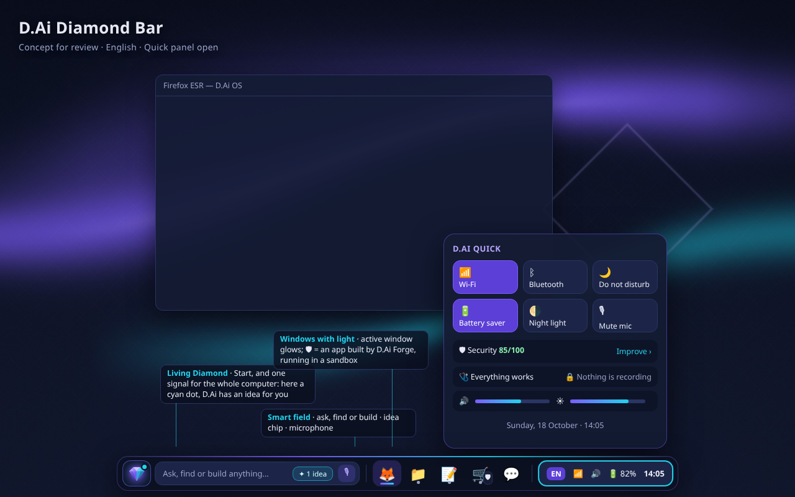
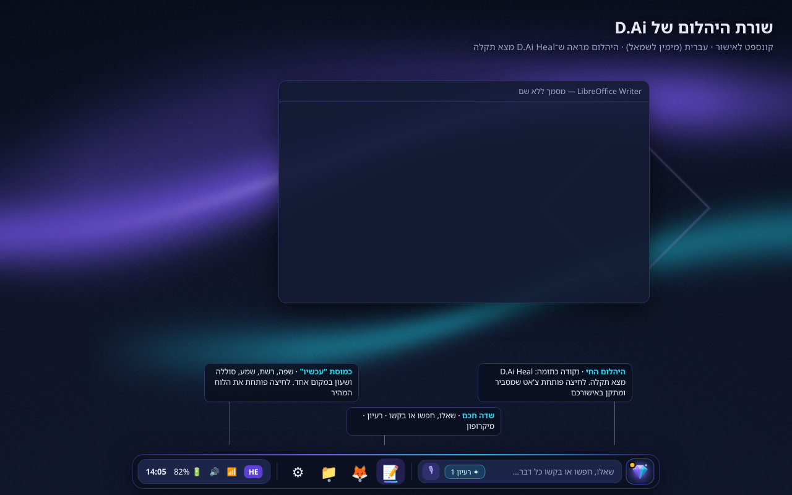

# D.Ai Diamond Bar: שורת משימות ייחודית

> **סטטוס:** אושר (§7). **שלב 1 (רענון חזותי) נבנה**, ומחכה לאימות בצילומי CI. שלבים 2–5 ממתינים.
> ⚠ = דורש אימות טכני ב־CI או על חומרה לפני שמתחייבים.

## 1. מה רוצים להשיג

שורת המשימות היום (צילום ב־README) עובדת, אבל נראית כמו LXQt רגיל: פס כהה ברוחב המסך, כפתורים שטוחים, ומגש
שנראה כמו בכל הפצה. המטרה: שורה שאפשר לזהות במבט אחד כ־D.Ai, ושעושה דברים שאין בשורות משימות אחרות. כל זה
**בלי לשלם בביצועים, בנגישות או בפרטיות**.

## 2. הקונספט: "שורת היהלום"

| אנגלית, עם הלוח המהיר פתוח | עברית (RTL), כש־Heal מצא תקלה |
|---|---|
|  |  |

> ה־mockup צויר ב־HTML על הרקע והגופנים האמיתיים של המערכת, כדי להראות את הכיוון. הצבעים והגדלים הסופיים ייקבעו ביישום.

```
            ╭──────────────────────────────────────────────────────────────────────────────╮
            │ 💎•  │ ✦ שאלו, חפשו או בקשו…  ✦ רעיון 1 🎙 │  ▣ ▣̲ ▣ ▣   │  HE  ▂▄▆ 🔊 🔋 14:05  │
            ╰──────────────────────────────────────────────────────────────────────────────╯
              יהלום חי        שדה חכם                  חלונות (אייקונים)    כמוסת "עכשיו" → לוח מהיר
```

### 2.1 היהלום החי (Living Diamond): ייחודי ל־D.Ai

כפתור "התחל" הוא גם **אות אחד שמסכם את מצב המחשב**. הוא עובד בלי פתיחת חלון ובלי התראות קופצות:

| מצב | איך נראה | לחיצה |
|-----|----------|-------|
| הכל תקין | יהלום סגול רגוע | תפריט התחל |
| ‏AI עובד או מאזין | טבעת ציאן "נושמת" | תפריט התחל |
| ‏D.Ai Heal מצא תקלה | נקודה כתומה בפינה | פותח את צ'אט Heal |
| מיקרופון או מצלמה בשימוש | נקודה אדומה, וגם שם האפליקציה בתיאור | יומן הפרטיות |
| יש רעיון מ־Evolve | נקודה ציאן קטנה | ההצעה ב־D.Ai Command |

- **גם קורא מסך שומע את זה:** השם הנגיש הוא "Start. D.Ai Heal found 1 problem". שינויים מוכרזים בעדינות (polite), כדי לא להפריע.
- **לא רק צבע:** כל מצב מסומן גם בצורה (נקודה, טבעת), כנדרש ב־WCAG 1.4.1.
- **בלי "פיפ" מתמשך:** הטבעת נושמת רק בזמן פעולה, ונעצרת לגמרי כשמבקשים להפחית תנועה (reduce motion).

### 2.2 השדה החכם

שדה הפקודה הקיים, עם שלושה דברים חדשים:
- **שבב רעיון ✦:** כש־Evolve מצא משהו, מופיע בתוך השדה שבב קטן ("✦ רעיון 1"). לחיצה פותחת את ההצעה. Delete מסתיר אותה.
- **כפתור מיקרופון 🎙 בתוך השדה:** ‏D.Ai Voice במקום אחד ברור.
- **רמזים מתחלפים בטקסט הריק:** "שאלו את ה־AI עם ?", "‏+ תבנה לי…", "Super+Space". כל רמז מוצג פעם בכניסה, והחלפה איטית בלבד.

### 2.3 חלונות: "אייקונים עם אור"

- כפתורי חלונות **אייקון בלבד** (השם בתיאור, וגם בשם הנגיש).
- החלון הפעיל מסומן ב**קו גרדיאנט סגול→ציאן**. חלון שמבקש תשומת לב מסומן בנקודה כתומה, ולא בהבהוב.
- **(שלב מאוחר, אופציונלי)** תג 🛡 על חלונות של אפליקציות שנבנו ב־Forge ורצות בארגז חול. זה סימן אמון שאין באף מערכת אחרת. דורש תוסף משימות משלנו (§3).

### 2.4 כמוסת "עכשיו" + הלוח המהיר

שפה, רשת, שמע, סוללה ושעון מאוחדים ב**כמוסה אחת** במקום חמישה אייקונים מפוזרים. לחיצה פותחת את **הלוח המהיר (D.Ai Quick)**:

```
╭──────────────── D.Ai Quick ────────────────╮
│ [📶 Wi‑Fi]  [ᛒ Bluetooth]  [🌙 לא להפריע]   │
│ [🔋 חיסכון]  [🌗 אור לילה]  [🎙 השתק מיק']   │
│ ───────────────────────────────────────── │
│ 🛡 אבטחה 85/100 · לשפר ›                   │
│ 🩺 הכל תקין      🔒 אף אפליקציה לא מקליטה   │
│ 🔊 ━━━━━━━━━━○──   ☀ ━━━━━━━━○────           │
│ יום א׳, 18 באוקטובר · 14:05                │
╰────────────────────────────────────────────╯
```

- **כל מתג הוא פעולת D.Ai Tune קיימת** (לדוגמה `power.profile`), או הגדרה של המשתמש בלבד. שינוי מערכת עובר כמו תמיד דרך Tune: polkit, יומן ו־undo. **אין בלוח שום root חדש.**
- **ציון האבטחה** מגיע מ־`dai-tune status`, ולחיצה מציגה מה לשפר.
- **"לא להפריע"** משתיק התראות (lxqt-notificationd). התראות פרטיות ואבטחה ממשיכות להופיע, כי הן מגינות על המשתמש.

### 2.5 מראה "אי צף" ⚠

שורה ממורכזת עם פינות מעוגלות ומרווח מקצה המסך, ורקע "זכוכית" כהה. ⚠ צריך לבדוק אם lxqt-panel 2.1.4 על
Wayland תומך במרווח (layer-shell margin) ובשקיפות עם פינות. **חלופה אם לא:** פס ברוחב מלא, שבתוכו "איים"
מעוגלים (יהלום+שדה, חלונות, כמוסה). זה עדיין ייחודי, וגם בטוח.

### 2.6 נגישות, RTL ומצבים

- **עברית וערבית:** כל השורה מתהפכת אוטומטית (Qt RTL), כולל הלוח המהיר.
- **מצב גדול** (56px, אייקונים 32px) ו**מצב ניגודיות גבוהה**. שניהם מופעלים ב־Tune ("הגדל את שורת המשימות").
- **מקלדת:**
  - ‏`Super+Space` פותח את השדה.
  - ‏`Super+N` פותח את הלוח המהיר. ⚠ מקש חדש: צריך לבדוק שאינו תפוס.
  - בתוך הלוח: ‏Tab ו־Enter, ו־Esc לסגירה.
- **ניגודיות:** כל טקסט ב־AA לפחות (הטוקנים ב־`docs/DESIGN.md` §2).

## 3. איך בונים: האפשרויות

| אפשרות | יתרונות | חסרונות | המלצה |
|--------|---------|---------|--------|
| **א. לשדרג את lxqt-panel** (ערכת QSS + תוספי C++ משלנו + לוח מהיר ב־PyQt) | מגש, משימות ונגישות עובדים כבר היום. משתמשים בצינור הבנייה של התוסף הקיים, והסיכון נמוך | מוגבלים למה שהפאנל מאפשר (צורה, אנימציות) | ✅ **מומלץ** |
| ב. פאנל משלנו מאפס (Qt C++ + LayerShellQt) | חופש עיצובי מלא, כולל אי צף אמיתי ואנימציות | צריך לכתוב מחדש מגש (SNI), משימות (foreign-toplevel) ונגישות: חודשים של עבודה ותחזוקה | לא עכשיו. אולי ב־v1.0 |
| ג. waybar או sfwbar עם CSS | ‏CSS גמיש, ותמיכה ב"צף" | ‏GTK (תלויות נוספות), תמיכה חלשה ב־RTL, בלי שילוב ב־LXQt | לא |

**טכני (אפשרות א):**
- **תוסף "daistatus" (C++)** באותה ספרייה של תוסף השדה. הוא מצייר את היהלום החי וקורא קובץ מצב אחד: `$XDG_RUNTIME_DIR/dai/status.json`.
  - הקובץ נקרא דרך inotify (`QFileSystemWatcher`), **בלי polling**.
  - הוא נכתב ע"י Heal, ‏Privacy, ‏Voice ו־Evolve, שכבר רצים. אין תהליך חדש.
- **הלוח המהיר (PyQt, `dai-quick`):** נפתח מלחיצה על הכמוסה ונסגר כשמאבדים פוקוס.
  - ⚠ מיקום ליד השורה ב־Wayland: בדיקה של `windowRule` ב־labwc (MoveTo או מיקום לפי identifier).
  - **חלופה:** הלוח מופיע במרכז התחתון של המסך.
- **הכמוסה:** איחוד ויזואלי ב־QSS של התוספים הקיימים (lang, ‏volume, ‏worldclock, ‏statusnotifier). לחיצה על השעון פותחת את `dai-quick`.

## 4. אבטחה ופרטיות

- **קובץ המצב** נמצא ב־`$XDG_RUNTIME_DIR`: תיקייה 0700 של המשתמש, בזיכרון בלבד, ונמחק ביציאה.
  - יש בו **רק מונים ודגלים**, למשל `{"heal": 1, "privacy": ["Zoom"], "ai": "busy"}`. אין בו תוכן, שאלות או שמות קבצים.
  - התוסף מתייחס לקובץ כקלט לא מהימן: גודל מוגבל, שדות ידועים בלבד, ומחרוזות מקוצרות ומוצגות כטקסט ולא כ־HTML.
- **הלוח המהיר לא מריץ פקודות מערכת בעצמו.** כל שינוי עובר דרך D.Ai Tune (polkit, ולידציה כפולה, יומן ו־undo).
- **פרטיות:** שם האפליקציה שמקליטה מוצג רק במחשב הזה. אין טלמטריה ואין לוגים חדשים.

## 5. שלבים

| שלב | מה | גודל |
|-----|----|------|
| 1 | **רענון חזותי:** ‏QSS + `panel.conf`. ניסיון "אי צף" ⚠ או איים, אייקונים עם אור, כמוסה, מצב גדול וניגודיות גבוהה. צילומי CI ב־he/en | קטן |
| 2 | **היהלום החי:** ‏`status.json`, כתיבה ע"י Heal/Privacy/Voice/Evolve, תוסף `daistatus` (C++) והכרזות נגישות | בינוני |
| 3 | **הלוח המהיר** `dai-quick` + ציון אבטחה + "לא להפריע" | בינוני |
| 4 | **השדה החכם:** שבב רעיון, מיקרופון ורמזים | קטן |
| 5 | (אופציונלי) תוסף משימות משלנו עם תג 🛡 לאפליקציות בארגז חול | גדול |

## 6. בדיקות

- **יחידה:** קריאת `status.json` (קובץ פגום, גדול מדי או שדות לא ידועים), מצבי היהלום והשם הנגיש, ומתגי הלוח שממופים לפעולות Tune.
- **VM ב־CI:**
  - צילום השורה בעברית ובאנגלית ובמצב גדול.
  - מצב Heal ← נקודה כתומה, ולחיצה פותחת את Heal.
  - הקלטה פעילה ← נקודה אדומה.
  - פתיחת הלוח המהיר ב־`Super+N`, וניווט במקלדת בלבד.
- **ביצועים:** זיכרון הפאנל לפני ואחרי. יעד: עד 15MB נוספים, ו־0% מעבד במנוחה.

## 7. החלטות (אושרו)

1. **אפשרות א:** שדרוג lxqt-panel.
2. **"אי צף"** כשאפשר.
3. **הלוח המהיר** נפתח גם מהכמוסה וגם ב־`Super+N`.

## 8. שלב 1: מה נבנה ומה נבדק

- **‏`panel.conf`:**
  - ‏`width=80`, ‏`width-percent=true`, ‏`alignment=0`: שורה ממורכזת. לפי הקוד של lxqt-panel 2.1.4, רוחב קטן מ־100% עם יישור למרכז מעגן רק לתחתית, ו־layer-shell ממרכז.
  - ‏`panelSize=56`, ‏`iconSize=26`.
  - חלונות כאייקונים (`buttonStyle=Icon`), עם קיבוץ לפי אפליקציה.
- **"אי צף":** חלון הפאנל שקוף (`WA_TranslucentBackground` בקוד), ו־`#BackgroundWidget` מקבל ב־QSS ‏`margin-bottom: 8px`, פינות 18px וגבול סגול שקוף־למחצה. **נבדק ברינדור Qt אמיתי** של ה־QSS על העתק של עץ הווידג'טים, עם אותם שמות מחלקה ואובייקט:
  - הקו התחתון של המסגרת נמצא 8px מעל התחתית, ומתחתיו שקוף.
  - **תקציב גובה:** ‏56 − 8 (רווח) − 2 (גבול) = 46px לכל כפתור. החשבון הראה שכפתורי החלונות (48px) חרגו, והם הוקטנו.
- **החלון הפעיל:** ‏`task-active.svg` (גוון סגול וקו סגול→ציאן) דרך `border-image`. חלון שמבקש תשומת לב מקבל מסגרת כתומה ולא הבהוב.
- **הקבוצה הימנית:** במקום כמוסה אחת זו שורה של מקטעים זהים, כל אחד מעוגל משני הצדדים. ל־QSS אין מאפיינים לוגיים (start/end), וכמוסה עם קצוות מעוגלים רק בחוץ הייתה מתהפכת לא נכון בעברית. גם הריפוד הפנימי סימטרי מאותה סיבה.
- **בדיקות CI:** קואורדינטות הלחיצה עודכנו. היהלום ב־(161,768) והשדה ב־(300,768), כי השורה ממורכזת עכשיו (x בין 128 ל־1152). צילומי `desktop.png`, ‏`apps.png` (עם חלונות) ו־`start-menu.png` יראו את השורה במערכת האמיתית.
- ⚠ **עדיין לא נבדק:** שהקומפוזיטור (labwc) מציג את השקיפות של layer-surface כמצופה. אם לא, נעבור לחלופה: פס מלא עם "איים".

---

© 2026 Diamond Rubinny (d.Ai) · D.Ai OS · Apache-2.0
