

# 💎 D.Ai OS: الحاسوب الذي ينمو معك

[English](../../README.md) · [עברית](../../README.md#בעברית) · **العربية** · [Русский](README.ru.md) · [Español](README.es.md) · [Français](README.fr.md) · [Deutsch](README.de.md) · [Português](README.pt.md)

**قل ما تحتاجه، فيبنيه النظام ويختبره ويصلحه، ويسألك قبل أي تغيير.**

🌐 **الموقع:** [rubinny.com](https://rubinny.com) · ⬇️ **التنزيل:** [أحدث إصدار](https://github.com/diamondrubinny/D.Ai/releases/latest)

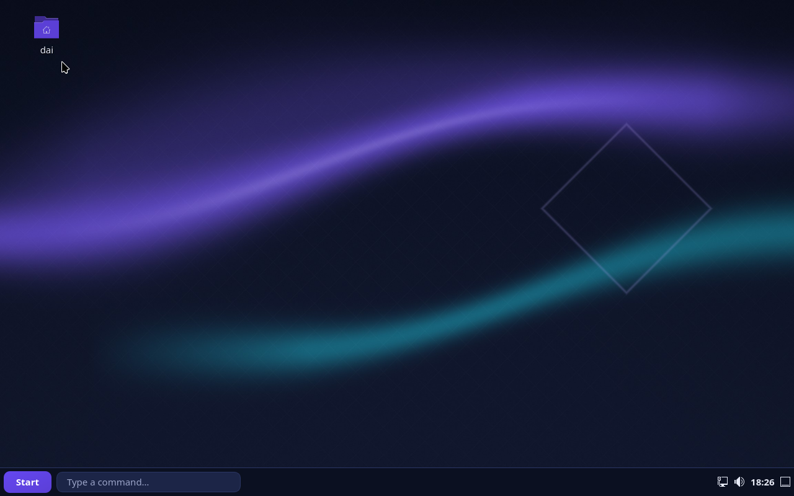

‏D.Ai OS نظام تشغيل مجاني ومفتوح المصدر مبني على Debian 13، من تطوير Diamond Rubinny (d.Ai)، مع ذكاء اصطناعي يعمل على حاسوبك فقط، وأمان مفعّل منذ الإقلاع الأول.

## ✨ ما الذي يميّزه

- **🛠 يبني ما تطلبه:** اكتب `+ تطبيق لقائمة التسوق` أو `+ ثبّت برنامج مكافحة فيروسات`، فيكتب D.Ai Forge التطبيق أو يجهّز الميزة، وأنت تراجع أولاً.
- **🧪 يختبر عمله بنفسه:** كل تطبيق يكتبه الذكاء الاصطناعي يُشغَّل أولاً في بيئة معزولة، وإذا تعطّل يصلحه من رسالة الخطأ ويختبره من جديد.
- **🔭 يلاحظ ما ينقصك:** ملف لا يفتحه أي برنامج، أو أمر تكرره كل يوم، فيقترح D.Ai Evolve بناء الحل.
- **🩺 يصلح نفسه:** عند تعطّل برنامج تُفتح محادثة تشرح ما حدث بلغة بسيطة، وتصلحه بنقرة واحدة بعد موافقتك فقط.
- **🗣 الإعدادات بالكلام:** «احجب وحدات USB وأقفل الشاشة بعد 5 دقائق» يتحول إلى خطة يمكنك مراجعتها والتراجع عنها.
- **🔒 الخصوصية أولاً:** الذكاء الاصطناعي يعمل محلياً وخدمته بلا اتصال بالشبكة. لا تتبّع ولا إعلانات ولا سحابة.
- **🌍 ثماني لغات:** العبرية والإنجليزية والعربية والروسية والإسبانية والفرنسية والألمانية والبرتغالية: الواجهة، والجمل التي يفهمها D.Ai، وقائمة الإقلاع، والموقع.
- **🪟 قادمون من Windows:** التركيز ووضع الألعاب بجملة، نافذة إعدادات بخطة وتراجع، متجر بلا حساب، الهاتف عبر KDE Connect، البحث داخل المستندات، «Firefox لا يتصل بالإنترنت»، الترجمة الحية وتوفير الذاكرة (docs/BEYOND.md).
- **🎨 جميل من الثانية الأولى:** قائمة إقلاع D.Ai، وشاشة تحميل يطلب فيها القرص المشفّر عبارة المرور، وشاشة دخول D.Ai، وثلاثة مظاهر (ليلي، نهاري، تباين عالٍ).
- **📦 تطبيقات يومية خاصة به:** ‏J (بريد موقّع ومشفّر، يستورد من Outlook)، و‏Ruby (متصفح مع حماية من التتبّع وuBlock Origin)، و‏MOM (مدير مهام يعرض التطبيقات لا العمليات)، و‏D.Ai Quick، و‏D.Ai Rescue (يعيد النظام من قرص USB بعد تحديث سيئ).
- **📄 ملفات PDF في بيئة معزولة:** يفتح D.Ai PDF كل ملف في بيئة معزولة، ويعرض ما «يريد» الملف فعله (JavaScript، تشغيل برامج، إرسال نماذج) ولا ينفّذه أبداً؛ الصفحات والنماذج والملاحظات وختم التوقيع والتسويد الحقيقي وOCR وتصغير الملف، كلها داخل البيئة المعزولة.
- **🪟 ويندوز في نافذة:** يشغّل D.Ai VM ويندوز من وسيط التثبيت الخاص بك وبمفتاحك (KVM، وUEFI مع Secure Boot، وTPM 2.0)؛ المجلد المشترك والحافظة وUSB مغلقة حتى تفعّلها بنفسك. لا يوزّع D.Ai ويندوز.
- **📺 على التلفاز وعلى الهاتف وعلى ARM:** إصدار tv يقلع إلى Kodi بالعبرية ويُدار بجهاز التحكم؛ وصور arm64 تجريبية للهاتف (Phosh) وللتلفاز تُبنى وتُقلع في QEMU ضمن CI.

## 📸 لقطات الشاشة

| | | |
|---|---|---|
| 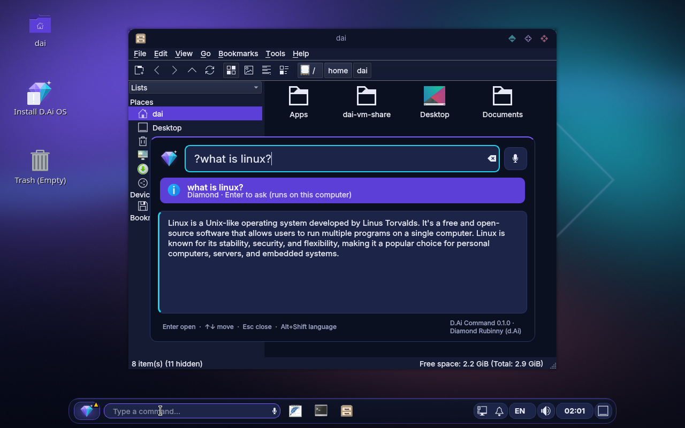 | 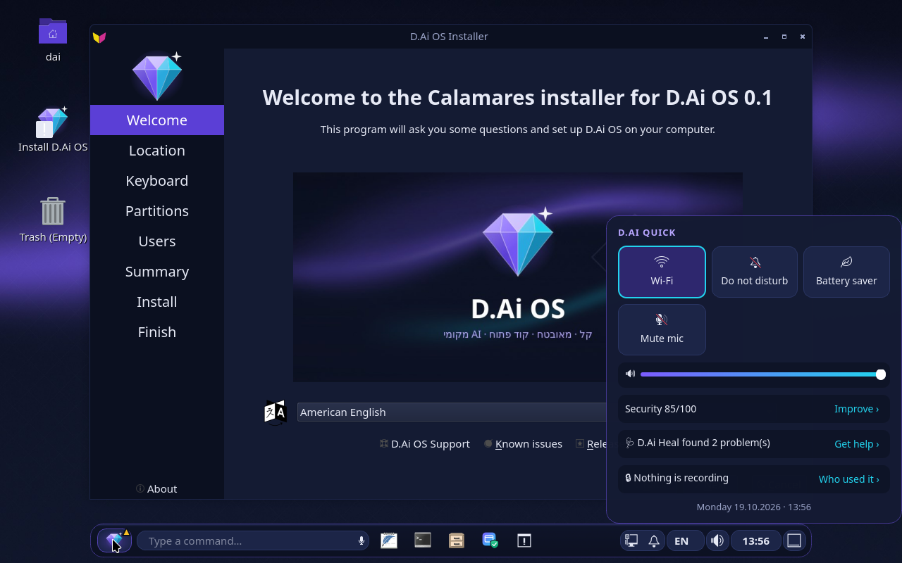 | 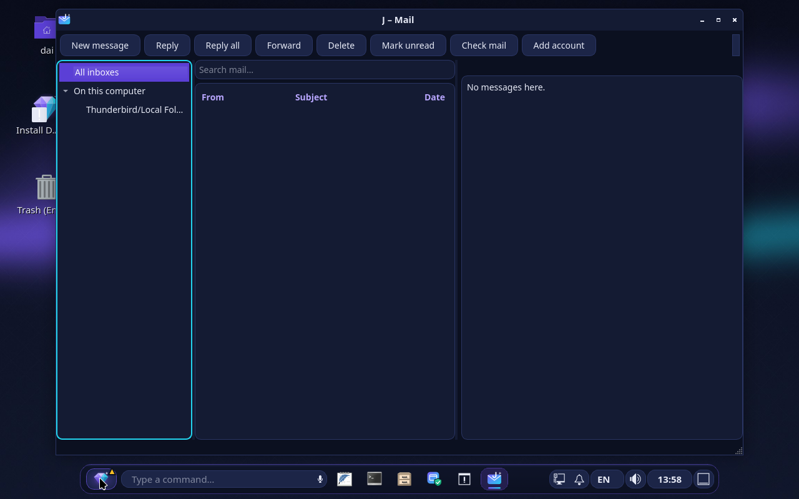 |
| **Diamond**: يجيب على هذا الحاسوب | **D.Ai Quick**: كل الإعدادات السريعة | **J**: بريد موقّع ومشفّر |
| 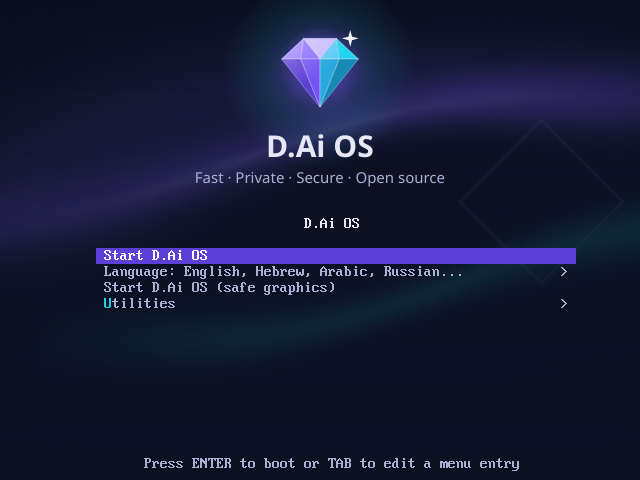 | 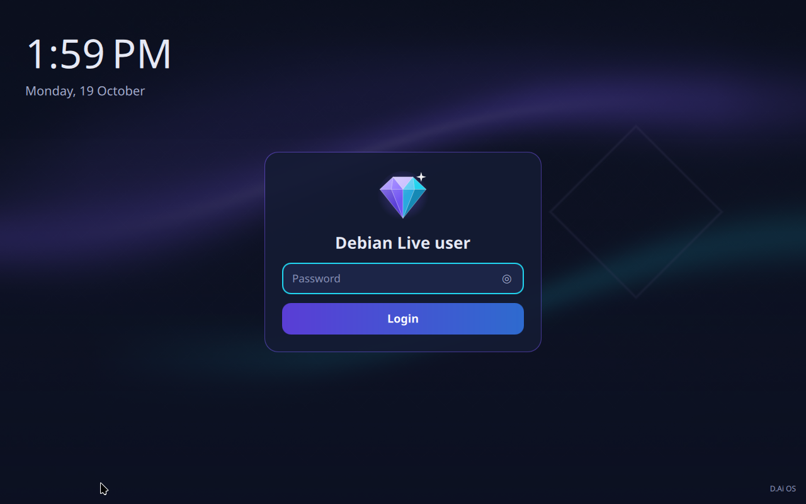 | 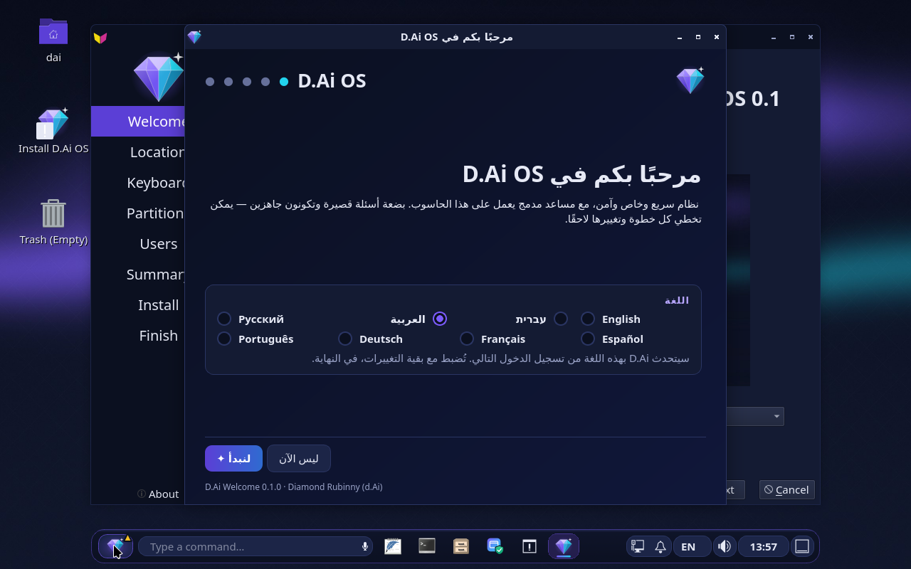 |
| **قائمة الإقلاع**: «Start D.Ai OS» | **شاشة الدخول**: شاشة D.Ai | **Welcome** بالعربية، من اليمين إلى اليسار |
|  | 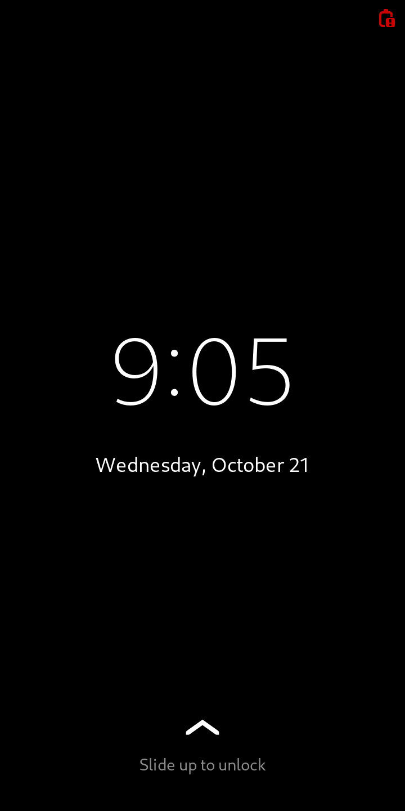 | 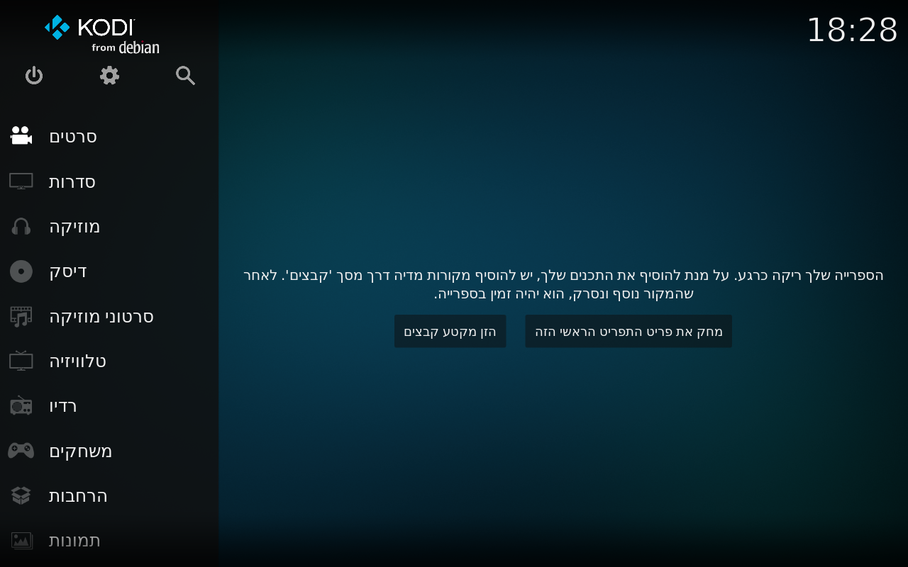 |
| **D.Ai TV**: ‏Kodi بالعبرية، لا شيء يستمع إلى الشبكة | **D.Ai Phone** (تجريبي): ‏Phosh على arm64، يقلع في QEMU | **D.Ai TV على arm64** (تجريبي): ‏Kodi نفسه، صورة UEFI عامة |
| 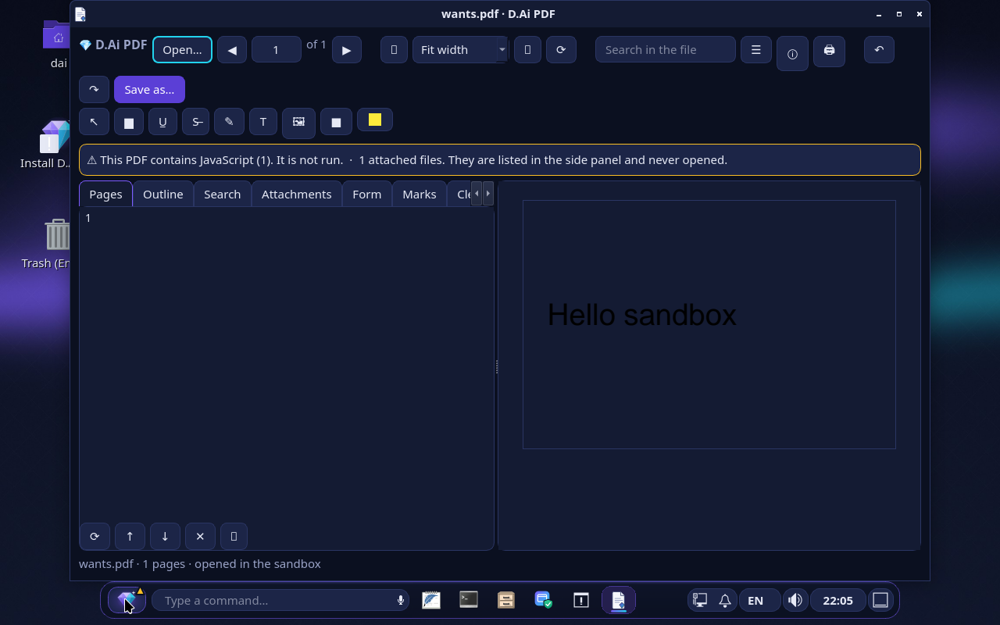 | 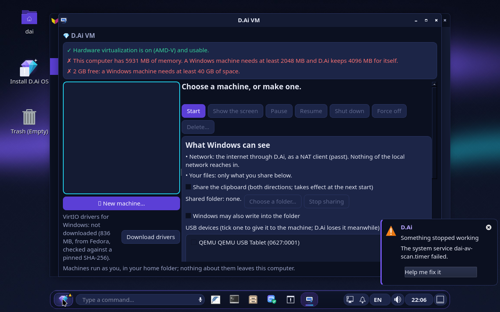 | |
| **D.Ai PDF**: ما يريده الملف يظهر في الشريط ولا يُنفَّذ | **D.Ai VM**: فحص العتاد، وما يراه ويندوز | |

## ⚠️ الحالة

إصدار ألفا مبكر. جرّبه من قرص USB قبل التثبيت. الواجهة والجمل التي يفهمها D.Ai والموقع متوفرة بالعربية (وبسبع لغات أخرى).

**الترخيص:** ‏Apache-2.0. ‏«D.Ai» و«D.Ai OS» وشعار الماسة علامات تجارية (`TRADEMARKS.md`).

> هذه ترجمة. نرحّب بتصحيحات من الناطقين بالعربية عبر Pull Request.

© 2026 Diamond Rubinny (d.Ai)

