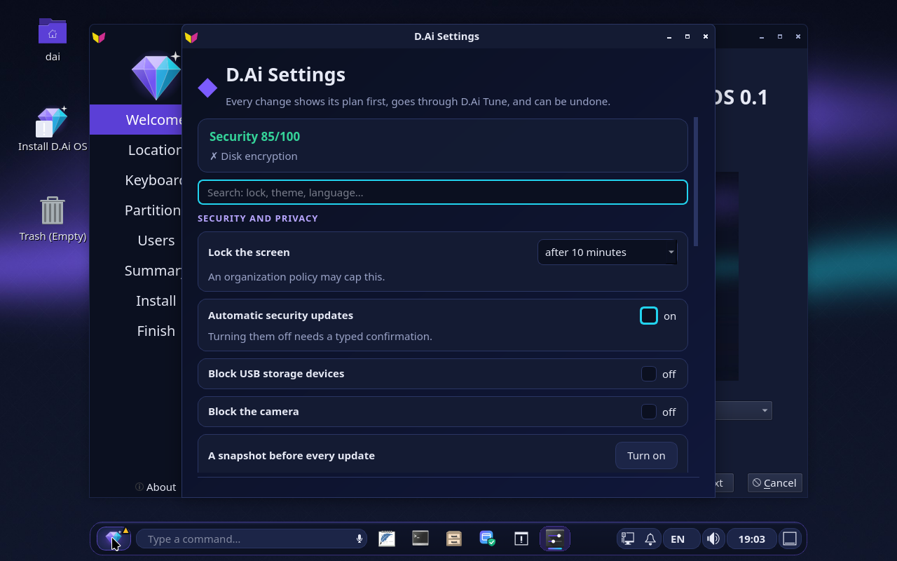
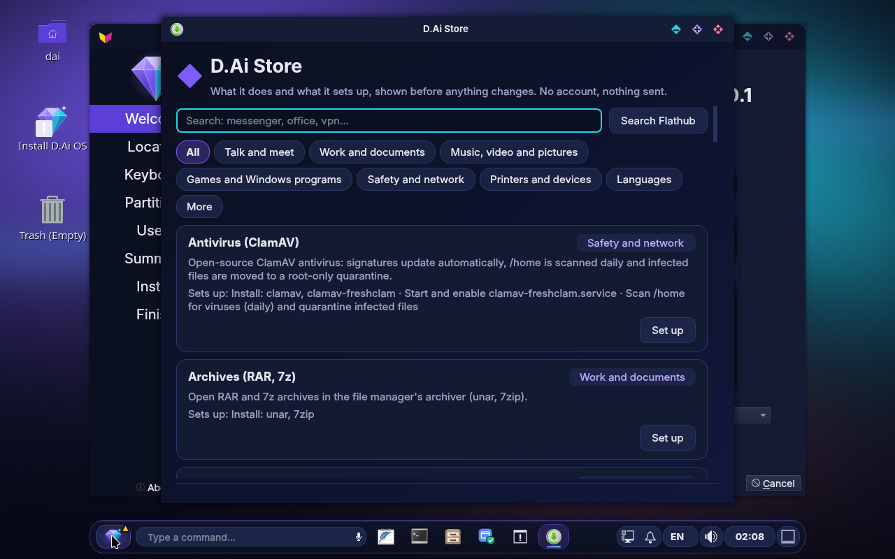
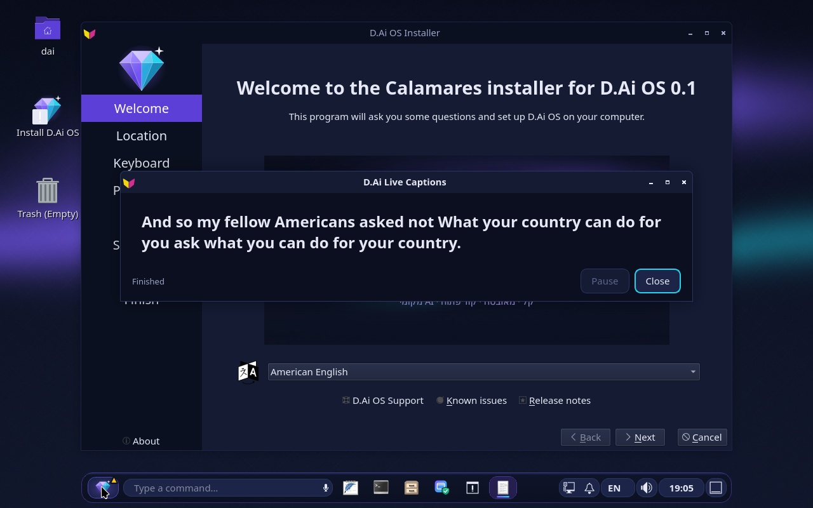

# 💎 D.Ai OS : l'ordinateur qui grandit avec vous

[English](../../README.md) · [עברית](../../README.md#בעברית) · [العربية](README.ar.md) · [Русский](README.ru.md) · [Español](README.es.md) · **Français** · [Deutsch](README.de.md) · [Português](README.pt.md)

**Dites-lui ce dont vous avez besoin. Il le construit, le teste, le corrige, et vous demande avant de modifier quoi que ce soit.**

🌐 **Site web :** [rubinny.com](https://rubinny.com) · ⬇️ **Télécharger :** [dernière version](https://github.com/diamondrubinny/D.Ai/releases/latest)

D.Ai OS est un système d'exploitation libre et gratuit basé sur Debian 13, créé par Diamond Rubinny (d.Ai). Son intelligence artificielle fonctionne uniquement sur votre ordinateur, et la sécurité est activée dès le premier démarrage.

## ✨ Ce qui le rend différent

- **🛠 Il construit ce que vous demandez :** tapez `+ une appli pour ma liste de courses` ou `+ installe un antivirus`. D.Ai Forge écrit l'appli ou configure la fonction, et vous vérifiez d'abord.
- **🧪 Il teste son propre travail :** chaque appli écrite par l'IA est d'abord lancée dans un bac à sable isolé. Si elle plante, l'IA la corrige à partir de l'erreur et la teste à nouveau.
- **🔭 Il remarque ce qui vous manque :** un fichier qu'aucun programme n'ouvre, une commande que vous tapez chaque jour. D.Ai Evolve propose de construire la solution.
- **🩺 Il se répare tout seul :** quand un programme plante, une discussion s'ouvre, explique simplement ce qui s'est passé et le répare en un clic, seulement avec votre accord.
- **🗣 Réglages en langage courant :** « bloque les clés USB et verrouille l'écran après 5 minutes » devient un plan que vous pouvez vérifier et annuler.
- **🔒 La vie privée d'abord :** l'IA fonctionne en local et son service n'a aucun accès au réseau. Pas de télémétrie, pas de publicité, pas de cloud.
- **🌍 Huit langues :** hébreu, anglais, arabe, russe, espagnol, français, allemand et portugais : l'interface, les phrases que D.Ai comprend, le menu de démarrage et le site web.
- **👁 Il voit l'écran et lit à voix haute :** `Super+Maj+E` (D.Ai Explain) : l'écran est lu sur l'ordinateur et, avec un modèle de vision local (SmolVLM), Diamond regarde l'image elle-même et l'explique dans ta langue, avec une étape suivante sûre. `Super+Maj+S` (D.Ai Speak) : le texte sélectionné, une page PDF, un courriel ou la réponse de Diamond sont lus à voix haute en huit langues, tout sur cet ordinateur (docs/EXPLAIN.md, docs/SPEAK.md).
- **🪟 Venir de Windows :** concentration et mode jeu en une phrase, une fenêtre de réglages avec plan et annulation, une boutique sans compte, le téléphone par KDE Connect, la recherche dans les documents, « Firefox ne va pas sur Internet », sous-titres en direct et économie de mémoire (docs/BEYOND.md).
- **🎨 Beau dès la première seconde :** un menu de démarrage D.Ai, un écran de chargement où le disque chiffré demande sa phrase secrète, un écran de connexion D.Ai et trois thèmes (Nuit, Jour et contraste élevé).
- **📦 Ses propres applis du quotidien :** J (courriel signé et chiffré, importe depuis Outlook), Ruby (navigateur avec protection contre le pistage et uBlock Origin), MOM (gestionnaire des tâches qui montre des applis, pas des processus), D.Ai Quick et D.Ai Rescue (remet le système en route depuis la clé USB après une mise à jour ratée).
- **📄 Des PDF dans un bac à sable :** D.Ai PDF ouvre chaque fichier dans un environnement isolé, montre ce que le fichier « veut » faire (JavaScript, lancer des programmes, envoyer des formulaires) et ne le fait jamais ; pages, formulaires, notes, une signature tamponnée, un vrai caviardage, l'OCR et un fichier plus léger, le tout dans le bac à sable.
- **🪟 Windows dans une fenêtre :** D.Ai VM lance Windows depuis votre propre support d'installation et avec votre propre clé (KVM, UEFI avec Secure Boot, TPM 2.0) ; dossier partagé, presse-papiers et USB restent coupés tant que vous ne les activez pas. D.Ai ne fournit jamais Windows.
- **📺 Sur la télé, sur le téléphone, sur ARM :** l'édition tv démarre dans Kodi en hébreu et se pilote à la télécommande ; des images arm64 expérimentales du téléphone (Phosh) et de la télé sont construites et démarrées dans QEMU en CI.

## 📸 Captures d'écran

| | | |
|---|---|---|
|  |  |  |
| **Diamond** : répond sur cet ordinateur | **D.Ai Quick** : les réglages rapides | **J** : courriel signé et chiffré |
|  |  |  |
| **Menu de démarrage** : « Start D.Ai OS » | **Connexion** : l'écran de D.Ai | **Welcome** en arabe, de droite à gauche |
|  |  |  |
| **D.Ai TV** : Kodi en hébreu, rien n'écoute sur le réseau | **D.Ai Phone** (expérimental) : Phosh sur arm64, démarré dans QEMU | **D.Ai TV sur arm64** (expérimental) : le même Kodi, une image UEFI générique |
|  |  | |
| **D.Ai PDF** : ce que le fichier veut est affiché dans la barre, jamais fait | **D.Ai VM** : la vérification du matériel, et ce que Windows voit | |
|  |  |  |
| **Réglages D.Ai** : une fenêtre, chaque changement avec son plan et l'annulation | **Boutique D.Ai** : trouver et installer des logiciels, sans compte | **Sous-titres D.Ai** : des sous-titres pour tout ce que l'ordinateur joue, sur l'ordinateur |

## ⚠️ État

Version alpha précoce. Essayez-le depuis une clé USB avant de l'installer. L'interface, les phrases que comprend D.Ai et le site web sont disponibles en français (et dans sept autres langues).

**Licence :** Apache-2.0. « D.Ai », « D.Ai OS » et le logo diamant sont des marques (`TRADEMARKS.md`).

> Ceci est une traduction. Les corrections de locuteurs natifs sont les bienvenues par Pull Request.

© 2026 Diamond Rubinny (d.Ai)
